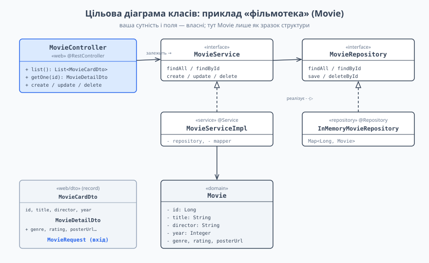
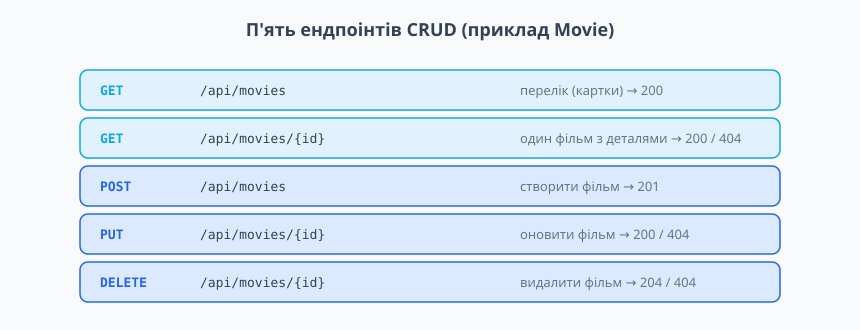

# Практичне заняття 1.3 — самостійний CRUD власної сутності

**Дисципліна:** Розробка застосунків на Spring Boot
**Модуль 1:** Spring Boot без бази даних
**Тип заняття:** практичне (2 год) · 8 балів

## Мета

Самостійно реалізувати **повний CRUD для власної сутності** у вашому проєкті — за тим
самим патерном, що був показаний на заняттях 1.1–1.2 для товарів, але на **іншій
предметній області** та з **іншими полями**.

Це завдання для **вашого власного репозиторію** (проєкту, який ви ведете з заняття 1.1).
Ця папка містить лише завдання й діаграми — **готового коду тут немає**, ви пишете його самі.

## Що здати

- Працюючі **5 ендпоінтів CRUD** вашої сутності (`GET` список, `GET` один, `POST`, `PUT`, `DELETE`).
- Поділ на шари (web / service / repository / domain) з інтерфейсами на межах.
- Окремі DTO (вихідні + вхідний `...Request`).
- Власний `requests.md` із прикладами `curl` на всі операції.

## Критерії

- Дотримано багатошарову структуру та інтерфейси (як у товарах).
- Назовні повертаються DTO, а не доменні об'єкти.
- Неіснуючий id дає `404`.
- Предметна область **власна** — поля відрізняються від товарів еталона.

---

## Оберіть свою сутність

Візьміть предметну область, відмінну від товарів. Наприклад:

| Сутність | Можливі поля |
|---|---|
| `Book` (книга) | title, author, price, year, genre, coverUrl |
| `Movie` (фільм) | title, director, year, genre, rating, posterUrl |
| `Recipe` (рецепт) | name, cuisine, minutes, difficulty, imageUrl |
| `Course` (курс) | title, author, hours, level, price |

Нижче як наскрізний приклад показано **`Movie`** (фільмотека) — **лише щоб проілюструвати
структуру**. Ви робите СВОЮ сутність зі СВОЇМИ полями.

### Цільовий результат — діаграма класів



### П'ять ендпоінтів, які мають вийти



---

## Покрокові завдання

### Крок 1. Доменна модель

Створіть клас своєї сутності у пакеті `domain` (напр. `Movie`). Оберіть **власні** поля
(мінімум 5), з-поміж них одне — для майбутнього фільтра (напр. `genre`). Без Spring-анотацій,
з конструктором і гетерами/сетерами.

> Підказка: орієнтуйтесь на `Product` із заняття 1.1, але поля — ваші.

### Крок 2. DTO

Створіть у `web/dto`:
- DTO для **переліку** (картка) — мінімум полів: `id` + 3–4 ключові;
- DTO для **сторінки** (деталі) — повний набір;
- **вхідний** DTO `...Request` (для `POST`/`PUT`) — **без `id`** (його задає сервер).

Усі — `record`.

> Підказка: аналог `ProductCardDto` / `ProductDetailDto` / `ProductRequest`.

### Крок 3. Репозиторій (інтерфейс + реалізація)

Інтерфейс у `repository` з методами:
```
List<Movie> findAll();
Optional<Movie> findById(Long id);
Movie save(Movie entity);
boolean deleteById(Long id);
```
In-memory реалізація (`@Repository`) на `ConcurrentHashMap` + `AtomicLong` для id.

> Підказка: аналог `ProductRepository` / `InMemoryProductRepository`.

### Крок 4. Сидер

Окремий компонент (`ApplicationRunner`, `@Component`) наповнює сховище 4–5 стартовими
записами при запуску, щоб перелік не був порожній.

> Підказка: аналог `ProductSeeder`. Дані додаються в КОДІ, не через `curl`.

### Крок 5. Маппер

Клас у `service/mapper` (`@Component`) з методами:
- `toCard(entity)` → DTO картки;
- `toDetail(entity)` → DTO деталей;
- `toDomain(request)` → доменний об'єкт (id не встановлювати тут).

> Підказка: аналог `ProductMapper`. Мапінг — окремо від сервісу (єдина відповідальність).

### Крок 6. Сервіс (інтерфейс + реалізація)

Інтерфейс у `service` з методами `findAll`, `findById`, `create`, `update`, `delete`.
Реалізація (`@Service`) залежить від **інтерфейсу** репозиторію та мапера (через конструктор).
Для неіснуючого id — власний виняток (напр. `MovieNotFoundException` у пакеті `exception`;
на цьому занятті з `@ResponseStatus(NOT_FOUND)`).

> Підказка: аналог `ProductService` / `ProductServiceImpl`. `update`/`delete` перевіряють
> існування запису й кидають виняток (404), якщо немає.

### Крок 7. Контролер

`@RestController` з `@RequestMapping("/api/<ваша-сутність>")` і п'ятьма методами:
`GET` (список), `GET /{id}`, `POST` (201), `PUT /{id}`, `DELETE /{id}` (204).

> Підказка: аналог `ProductController`. Коди відповіді — через `@ResponseStatus` / `ResponseEntity`.
> Для `POST`/`PUT` тіло читається через `@RequestBody`.

### Крок 8. Перевірка через curl

Запустіть застосунок і перевірте всі операції. Приклади (підставте свою сутність):

```bash
# перелік
curl http://localhost:8080/api/movies

# один
curl http://localhost:8080/api/movies/1

# неіснуючий → 404
curl -i http://localhost:8080/api/movies/999

# створити → 201
curl -i -X POST http://localhost:8080/api/movies \
  -H "Content-Type: application/json" \
  -d '{ "title": "Inception", "director": "Nolan", "year": 2010, "genre": "Sci-Fi" }'

# оновити → 200 / 404
curl -i -X PUT http://localhost:8080/api/movies/1 \
  -H "Content-Type: application/json" \
  -d '{ "title": "Inception (reissue)", "director": "Nolan", "year": 2010, "genre": "Sci-Fi" }'

# видалити → 204 / 404
curl -i -X DELETE http://localhost:8080/api/movies/2
```

Зафіксуйте ці приклади у власному `requests.md`.

> ⚠️ Запускайте застосунок і тести під **Java 21** (`JAVA_HOME=$(/usr/libexec/java_home -v 21)`).
> Якщо порт 8080 зайнятий — звільніть його або запустіть на іншому (`--server.port=8081`).

---

## 🏠 Самостійна робота

1. Завершити CRUD своєї сутності, якщо не встигли на парі.
2. Додати ще одне поле та **фільтр за ним** (напр. `GET /api/movies?genre=...` через `@RequestParam`).
3. (За бажанням, задаток до 1.4) додати базову валідацію вхідного DTO: `@NotBlank` на назву,
   `@Positive` на числове поле, `@Valid` у контролері; показати в `requests.md` запит, що
   порушує валідацію.

---

## Джерела

1. Spring Framework Documentation. *Web MVC — Mapping Requests (@RestController, @GetMapping, @PathVariable).* https://docs.spring.io/spring-framework/reference/web/webmvc/mvc-controller/ann-requestmapping.html
2. Spring Framework Documentation. *Web MVC — @RequestBody.* https://docs.spring.io/spring-framework/reference/web/webmvc/mvc-controller/ann-methods/requestbody.html
3. MDN Web Docs. *HTTP request methods.* https://developer.mozilla.org/en-US/docs/Web/HTTP/Methods
