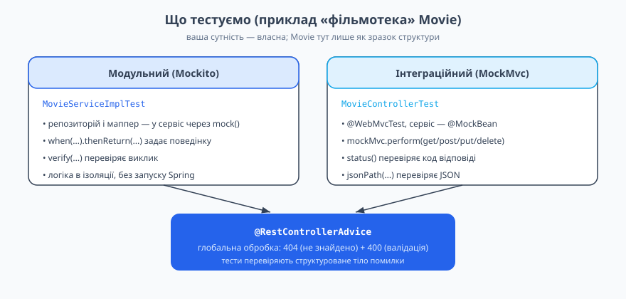
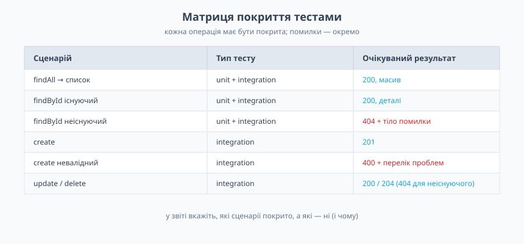

# Практичне заняття 1.5 — покриття власної сутності тестами та обробка помилок

**Дисципліна:** Розробка застосунків на Spring Boot
**Модуль 1:** Spring Boot без бази даних
**Тип заняття:** практичне (2 год) · 8 балів

## Мета

Покрити **власну сутність** (ту, яку ви створили на практичному занятті 1.3) модульними
та інтеграційними тестами й додати глобальну обробку помилок — за тим самим патерном, що
був показаний на занятті 1.4 для товарів.

Це завдання для **вашого власного репозиторію**. Готового коду тут немає — ви пишете його
самі; ця папка містить лише завдання та діаграми.

## Передумови

У вас уже є проєкт із заняття 1.3: власна сутність із повним CRUD (5 ендпоінтів), шари
web / service / repository / domain, DTO.

## Що здати

- Модульні тести сервісу (Mockito) та інтеграційні тести контролера (`@WebMvcTest` + `MockMvc`).
- Глобальний `@RestControllerAdvice` з обробкою `404` і `400`.
- Тести, що перевіряють структуроване тіло помилки.
- Зелений `./mvnw test` і короткий звіт: які сценарії покрито, а які — ні (і чому).

## Критерії

- Модульний тест ізолює сервіс (репозиторій і маппер — через `mock`).
- Інтеграційний тест використовує `@WebMvcTest` + `MockMvc` + `jsonPath`.
- Усі помилки повертають єдиний формат відповіді.
- Предметна область власна (сутність відрізняється від товарів еталона).

---

## Цільовий результат

Структура тестів (приклад — сутність `Movie`, у вас власна):



Що саме покрити:



---

## Покрокові завдання

### Крок 1. Модульний тест сервісу (Mockito)

Створіть `<Сутність>ServiceImplTest` у `src/test/.../service/`. Залежності сервісу
(репозиторій, маппер) підмініть `mock()`; маппер можна взяти справжній, якщо він простий.

Покрийте:
- `findById` існуючого запису — повертає DTO деталей;
- `findById` неіснуючого — кидає ваш виняток «не знайдено»;
- `create` — зберігає й повертає з призначеним `id`.

> Підказка: `mock(...)`, `when(...).thenReturn(...)`, `verify(...)`,
> `assertThatThrownBy(...).isInstanceOf(...)`. Аналог `ProductServiceImplTest` із 1.4.

### Крок 2. Інтеграційний тест контролера (@WebMvcTest + MockMvc)

Створіть `<Сутність>ControllerTest`. Сервіс підміняється `@MockBean`.

Покрийте:
- `GET` список → `200`, перевірка поля через `jsonPath`;
- `GET /{id}` → `200` з деталями;
- `GET /{id}` неіснуючий → `404`;
- `POST` валідний → `201`; `PUT` → `200`/`404`; `DELETE` → `204`/`404`.

> Підказка: `mockMvc.perform(get/post/put/delete(...))`, `status().isOk()/isCreated()/...`,
> `jsonPath("$.field").value(...)`. Для тіла запиту — `contentType(APPLICATION_JSON).content(json)`.
> Аналог `ProductControllerTest` із 1.4.

### Крок 3. Додати валідацію вхідного DTO

Якщо ще не зробили на 1.3: додайте залежність `spring-boot-starter-validation`, правила
на вхідному DTO (`@NotBlank`, `@Positive`) і `@Valid` у контролері на тілі запиту.

> Підказка: валідація дає можливість перевірити сценарій `400`.

### Крок 4. Глобальна обробка помилок

Створіть `ErrorResponse` (record: `status`, `error`, `message`, `details`) і
`GlobalExceptionHandler` (`@RestControllerAdvice`) з обробниками:
- вашого винятку «не знайдено» → `404` зі структурованим тілом;
- `MethodArgumentNotValidException` (невалідний `@Valid`) → `400` з переліком проблем.

Приберіть `@ResponseStatus` з винятку «не знайдено» — тепер статус і тіло формує обробник.

> Підказка: аналог `GlobalExceptionHandler` із 1.4. `@WebMvcTest` сканує `@ControllerAdvice`,
> тож обробник бере участь у тесті контролера.

### Крок 5. Тести на помилки

Додайте до тесту контролера:
- `404` з перевіркою тіла (`jsonPath("$.status").value(404)`, `$.message`);
- `400` для невалідного тіла (`jsonPath("$.details").isArray()`).

### Крок 6. Прогін і звіт

```bash
JAVA_HOME=$(/usr/libexec/java_home -v 21) ./mvnw test
```
Усі тести мають бути зелені. У README вашого проєкту додайте короткий звіт: перелік
покритих сценаріїв (див. матрицю вище) і які лишилися непокритими та чому.

> ⚠️ Тести Mockito **не працюють під новішими JDK** (напр. 25) — запускайте під **Java 21**.

---

## 🏠 Самостійна робота

1. Добити покриття своєї сутності до **всіх** CRUD-операцій.
2. Додати тест на валідацію (`400`) і на «не знайдено» (`404`), якщо ще немає.
3. Коротко описати в README, які сценарії лишилися непокритими і чому.

---

## Джерела

1. Spring Framework Documentation. *Testing — Unit Testing (Mock Objects).* https://docs.spring.io/spring-framework/reference/testing/unit.html
2. Spring Boot Documentation. *Testing — Auto-configured Spring MVC Tests (@WebMvcTest, MockMvc).* https://docs.spring.io/spring-boot/reference/testing/spring-boot-applications.html
3. Spring Framework Documentation. *Web MVC — Exception Handling (@ExceptionHandler, @ControllerAdvice).* https://docs.spring.io/spring-framework/reference/web/webmvc/mvc-controller/ann-exceptionhandler.html
