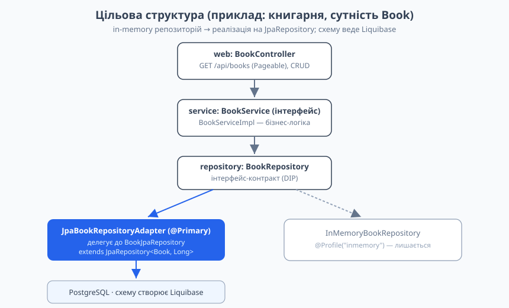
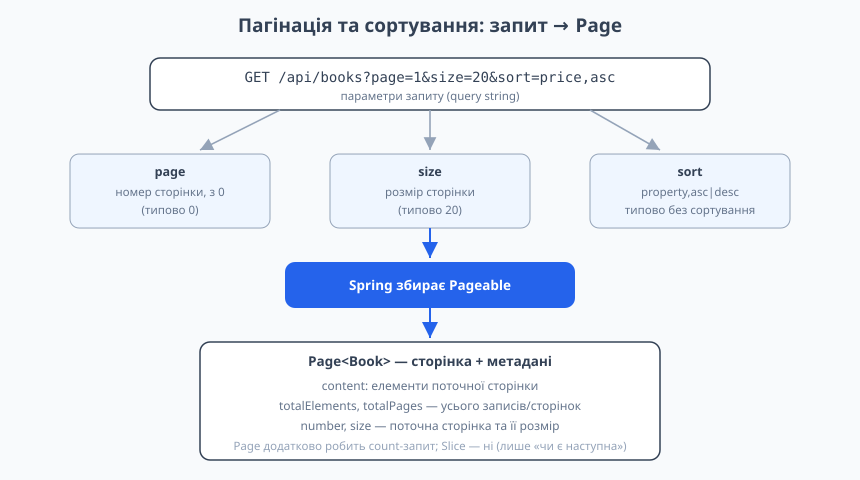
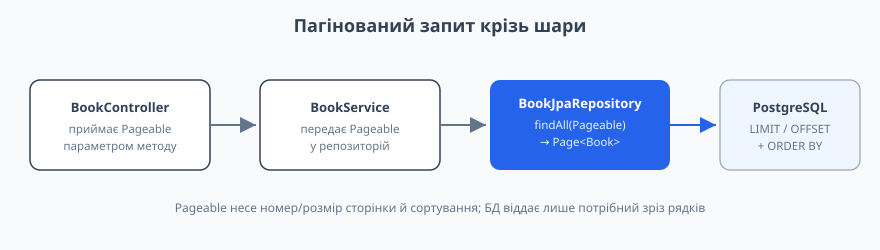

# Практичне заняття 2.3 — CRUD власної сутності в PostgreSQL + пагінація і сортування

**Дисципліна:** Розробка застосунків на Spring Boot
**Модуль 2:** Робота з базами даних
**Тип заняття:** практичне (4 год)

## Мета

Перенести **власну сутність** (ту, яку ви ведете з Модуля 1) з пам'яті у **PostgreSQL** за
патерном, показаним на заняттях 2.1–2.2: сутність як `@Entity`, реалізація репозиторію на
`JpaRepository`, схема й стартові дані через міграції Liquibase. Додати **пагінацію і
сортування** переліку (`Pageable`, `Page<T>`, параметри `?page=&size=&sort=`). Оглядово —
познайомитися з SQL-view (VIEW) і збереженою функцією. Лише backend, у **власному
репозиторії**.

## Бали

Заняття **2/3 (ПЗ)** — максимум **10 балів**.

Бали виставляються за результатами **усного опитування викладача** — **5 питань по 2 бали**
за кожне. Питання стосуються **пройденого на занятті матеріалу та виконаної практичної роботи**,
наприклад: як in-memory репозиторій замінено на `JpaRepository` без зміни сервісу/контролера
(DIP); що таке `Pageable`, `Page<T>` і чим `Page` відрізняється від `Slice`; як параметри
`?page=&size=&sort=` перетворюються на `Pageable`; як працюють похідні методи (derived queries)
та `@Query` (JPQL); навіщо SQL-view (VIEW) і збережена функція та як викликати їх із JPA.

## Передумови

- Виконано самостійні роботи Модуля 1: у вас є власний CRUD-застосунок із сутністю у пам'яті
  (інтерфейс репозиторію + in-memory реалізація, сервіс, контролер, DTO).
- Переглянуто заняття 2.1 (JPA, Testcontainers) і 2.2 (Liquibase) — цей практикум застосовує
  той самий підхід до **вашої** предметної області.

## Що здати

1. У **вашому** репозиторії — CRUD вашої сутності працює **на PostgreSQL** (БД у Docker).
2. Схему й стартові дані створює **Liquibase** (`createTable` + `insert`), `ddl-auto: validate`;
   стартових записів **достатньо** (15–30), щоб пагінація показувала кілька сторінок.
3. **Пагінований і сортований** ендпоінт `/page` (`?page=&size=&sort=`), що повертає сторінку
   карток із метаданими (власний `PageDto` поверх `Page<T>`).
4. Фільтр за полем (похідний метод або `@Query`).
5. Integration-тести з реальним Postgres через **Testcontainers** — зелені.
6. У `requests.md` показано дві різні сторінки переліку (напр. `page=0` і `page=1`).

## Критерії

- Заміна сховища не торкнулася сервісу/контролера (DIP): змінилась лише реалізація репозиторію.
- Схема повністю під Liquibase; `ddl-auto: validate`; на чистій базі все створюється само.
- Перелік віддає `Page<T>` з метаданими (кількість записів/сторінок), сортування працює.
- Тести автономні (чистять БД перед кожним; кожен готує свої дані) і зелені.
- Предметна область **власна** (поля відрізняються від еталона).

## Цільовий результат



---

## Покрокові завдання

> Наскрізний приклад тут — **книгарня** (сутність `Book`). Ви робите те саме для **своєї**
> сутності. Код рішення не наводиться — лише орієнтири, анотації та скелети сигнатур.

### Крок 1. Підготувати залежності й БД

ПІДКАЗКА: у `pom.xml` вже (з Модуля 1) є web-стартер. Додайте те, що з'явилось у Модулі 2:
`spring-boot-starter-data-jpa`, драйвер `org.postgresql:postgresql` (runtime),
`org.liquibase:liquibase-core`, а для тестів — `spring-boot-testcontainers`,
`org.testcontainers:junit-jupiter`, `org.testcontainers:postgresql`.
Підніміть PostgreSQL через власний `docker-compose.yml` (образ `postgres:16-alpine`).

### Крок 2. Перетворити сутність на `@Entity`

ПІДКАЗКА: позначте клас `@Entity`/`@Table`, ключ — `@Id` + `@GeneratedValue(strategy = IDENTITY)`.
Колекції значень (якщо є) — `@ElementCollection` + `@CollectionTable`; порядок — `@OrderColumn`.
Уникайте зарезервованих слів SQL в іменах колонок (`value`, `order` → інші імена через
`@Column(name = ...)`). Доменний контракт (поля, гетери/сетери) не змінюйте — щоб сервіс і
контролер лишилися незмінними.

### Крок 3. Реалізувати репозиторій на JpaRepository (зберегти DIP)

Ваш **інтерфейс** репозиторію з Модуля 1 лишається контрактом. Додайте:
- Spring Data інтерфейс: `interface BookJpaRepository extends JpaRepository<Book, Long> { }`;
- **адаптер** `JpaBookRepositoryAdapter implements BookRepository` з `@Primary`, що делегує
  виклики у `BookJpaRepository`;
- стару in-memory реалізацію позначте `@Profile("inmemory")` — хай лишається.

Сервіс і контролер НЕ змінюються — вони залежать від інтерфейсу (інверсія залежностей).

### Крок 4. Міграції Liquibase (схема + seed)

ПІДКАЗКА: `application.yaml` → `ddl-auto: validate`, `spring.liquibase.change-log:
classpath:db/changelog/db.changelog-master.yaml`. Головний файл `include`-ом підключає:
- `001-create-<table>.yaml` — `createTable` вашої таблиці (типи/імена колонок мають збігатися
  з тим, що очікує Hibernate, інакше `validate` не пройде);
- `002-seed-<table>.yaml` — `insert` стартових записів. Якщо задаєте `id` явно — наприкінці
  зсуньте лічильник (`ALTER TABLE ... ALTER COLUMN id RESTART WITH N`).

**ВАЖЛИВО — зробіть ДОСТАТНЬО записів для пагінації.** Основна тема заняття — пагінація, а щоб
вона була помітна, записів має бути більше за розмір сторінки (візьміть **15–30**). Один запис =
один блок `insert`. Щоб не писати їх руками, згенеруйте YAML у терміналі (підставте свої поля):
```bash
for i in $(seq 1 20); do printf '        - insert:\n            tableName: books\n            columns:\n              - column: {name: id, valueNumeric: %s}\n              - column: {name: title, value: "Книга %s"}\n              - column: {name: price, valueNumeric: %s.00}\n' "$i" "$i" "$((100 + i * 20))"; done
```
Вивід вставте у `changes:` вашого seed-changeSet.

**Додавати дані — лише НОВИМ changeSet'ом.** Liquibase зберігає контрольну суму (checksum)
кожного застосованого changeSet. Якщо відредагувати вже застосований (`002`), застосунок впаде
з помилкою невідповідності. Тому докидайте записи окремим файлом (`003-seed-more-...`), а не
правкою наявного.

### Крок 5. Пагінація і сортування (ОСНОВНА тема)



Додайте пагінований перелік. Факти (звірено з документацією Spring Data [1][2]):
- метод репозиторію приймає `Pageable` і повертає `Page<T>`; `Page` знає загальну кількість
  елементів і сторінок (робить додатковий count-запит). `Slice` цього не робить (знає лише,
  чи є наступний зріз) — легший для великих наборів [1];
- контролер приймає `Pageable` параметром методу; Spring збирає його з параметрів запиту.
  Типові імена й значення [2]: `page` (номер, з 0, типово 0), `size` (типово 20),
  `sort=property,asc|desc` (кілька `sort` — для кількох полів).

Скелет (БЕЗ тіла — реалізуєте самі):
```java
// репозиторій
Page<Book> findAll(Pageable pageable);          // або власний @Query + countQuery

// контролер — ОКРЕМИЙ ендпоінт /page (старий GET без пагінації лишіть для сумісності)
@GetMapping("/page")
PageDto<BookCardDto> page(Pageable pageable) { /* делегувати в сервіс, змапити вміст */ }
```

**Назовні краще віддавати власний вузький `PageDto`, а не Spring-тип `Page` цілком** (у `Page`
багато службових полів). Зробіть record із потрібним клієнту: `content`, `page`, `size`,
`totalElements`, `totalPages`. Сервіс мапить `Page<Book>` у `PageDto<BookCardDto>`. Це той самий
принцип відокремлення контракту API від внутрішніх типів, що й зі звичайними DTO.



### Крок 6. Фільтр за полем

Додайте фільтр (напр. за автором/категорією) одним зі способів:
- **похідний метод** (derived query): `Page<Book> findByAuthorContainingIgnoreCase(String a, Pageable p);`
- або **`@Query`** (JPQL) з умовою `(:param IS NULL OR ...)`, щоб параметр був опційним.

### Крок 7. Інтеграційні тести (Testcontainers)

ПІДКАЗКА: спільний singleton-контейнер у базовому класі (`static PostgreSQLContainer` +
`@DynamicPropertySource`), усі `@SpringBootTest` його `extends`. Тести **автономні**:
`@BeforeEach` чистить БД, кожен тест сам створює потрібні записи й перевіряє лише їх. Додайте
тест пагінації: створіть, скажімо, 25 записів і перевірте, що `size=10` дає 10 елементів у
вмісті та `totalElements=25`.

### Крок 8 (оглядово, на самопідготовку). VIEW і збережена функція

Це не оцінюється як основне, але варто спробувати — щоб знати, що таке існує.
- **SQL-view (VIEW)** — збережений іменований запит, який можна читати як таблицю [3].
  Приклад: view «книги зі знижкою». Створюється changeSet'ом Liquibase (`createView` або
  `CREATE VIEW ...`), читається з JPA нативним запитом
  `@Query(value = "SELECT ... FROM books_discounted", nativeQuery = true)`.
- **Збережена функція** — іменований код у БД, що повертає значення [4]. Приклад: підрахунок
  книг за автором. Створюється `CREATE FUNCTION ...` у міграції, викликається нативним запитом.
- За бажанням: **пагінація поверх view** — нативний `@Query` з окремим `countQuery` і `Pageable`
  (повертає `Page`); а також **міграція ДАНИХ** — `UPDATE`-changeSet, що правит уже наявні рядки
  (напр. проставляє коректну картинку за категорією). Міграцією змінюють не лише схему, а й дані.

---

## 🏠 Самостійна робота

- Додати фільтр + пагінацію з сортуванням для своєї сутності (якщо не встигли на парі).
- Створити **1 VIEW** (напр. «товари/книги зі знижкою») і **1 збережену функцію** (напр.
  підрахунок за категорією/автором), викликати їх із застосунку.
- У `requests.md` показати дві сторінки переліку (різні `page`) і виклик view/функції.

---

## Джерела

1. Spring Data JPA Documentation. *Defining Query Methods — Paging, Sorting (Pageable, Page, Slice, Sort).* https://docs.spring.io/spring-data/jpa/reference/repositories/query-methods-details.html
2. Spring Data JPA Documentation. *Web support — Pageable/Sort request parameters.* https://docs.spring.io/spring-data/jpa/reference/repositories/core-extensions.html
3. PostgreSQL Documentation. *CREATE VIEW.* https://www.postgresql.org/docs/current/sql-createview.html
4. PostgreSQL Documentation. *CREATE FUNCTION.* https://www.postgresql.org/docs/current/sql-createfunction.html
