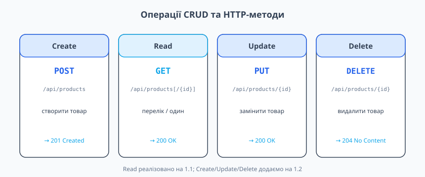
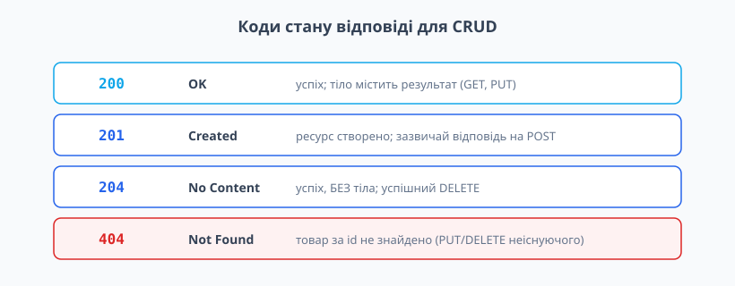
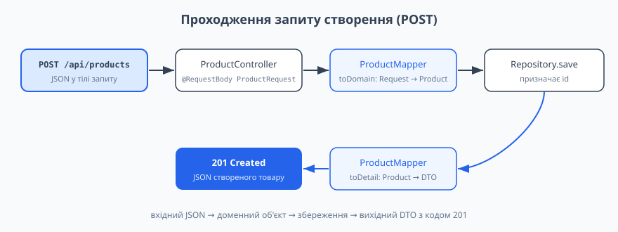

# Заняття 1.2. Повний CRUD: зміна даних через REST API

**Дисципліна:** Розробка застосунків на Spring Boot
**Модуль 1:** Spring Boot без бази даних
**Тип заняття:** групове (2 год)

## Передумови

Заняття продовжує 1.1. Передбачається, що ви знайомі з багатошаровою структурою
(`domain` / `repository` / `service` / `web`), інтерфейсами на межах шарів, впровадженням
залежностей і поняттям DTO. Код цього заняття — приріст до застосунку заняття 1.1.

## Навчальні результати

Після заняття студент здатен:

1. пояснити призначення HTTP-методів `POST`, `PUT`, `DELETE` для зміни ресурсів;
2. реалізувати ендпоінти створення, оновлення та видалення в Spring MVC;
3. зчитувати тіло запиту через `@RequestBody` і параметр запиту через `@RequestParam`;
4. повертати коректні коди стану відповіді (`201 Created`, `204 No Content`) за допомогою
   `@ResponseStatus` та `ResponseEntity`;
5. пояснити, навіщо розділяти вхідний DTO запиту та вихідні DTO відповіді.

Матеріал спирається на офіційну документацію Spring та MDN (див. «Джерела»).

---

## 1. Операції CRUD і HTTP-методи

**CRUD** — скорочення від Create, Read, Update, Delete (створити, прочитати, оновити,
видалити) — чотири базові операції над даними. У REST кожній із них відповідає HTTP-метод.

На занятті 1.1 було реалізовано лише читання (`GET`). На цьому занятті додаємо решту —
операції зміни даних.

| Операція | HTTP-метод | Ендпоінт | Призначення (за MDN) |
|---|---|---|---|
| Read (перелік) | `GET` | `/api/products` | запитує подання ресурсу; лише читає [1] |
| Read (один) | `GET` | `/api/products/{id}` | — |
| Create | `POST` | `/api/products` | надсилає дані, зазвичай змінюючи стан сервера (створення) [1] |
| Update | `PUT` | `/api/products/{id}` | повністю замінює наявний ресурс переданими даними [1] |
| Delete | `DELETE` | `/api/products/{id}` | видаляє вказаний ресурс [1] |



---

## 2. Коди стану відповіді

HTTP-відповідь містить **код стану** (*status code*) — число, що повідомляє результат
запиту. Для операцій зміни важливо повертати правильний код, а не завжди `200 OK`.

- **`201 Created`** — запит призвів до створення ресурсу; зазвичай надсилається у відповідь
  на `POST` [2]. Тіло відповіді може містити створений ресурс [2].
- **`204 No Content`** — запит успішний, але тіло відповіді відсутнє; відповідь **не повинна
  містити тіла** [3]. MDN прямо вказує `204` як результат успішного `DELETE` [3].
- **`404 Not Found`** — ресурс за вказаним id не знайдено (успадковано з 1.1).



У коді контролера коди задаються двома способами:

- `@ResponseStatus(HttpStatus.CREATED)` над методом — фіксований код для всіх відповідей методу;
- `ResponseEntity` — об'єкт, що дозволяє зібрати відповідь із потрібним кодом програмно
  (використано для `204` у `DELETE`).

---

## 3. Вхідні дані запиту: `@RequestBody` і `@RequestParam`

### 3.1. Тіло запиту — `@RequestBody`

Під час створення чи оновлення клієнт надсилає дані товару в **тілі запиту** у форматі JSON.
Анотація `@RequestBody` **зчитує тіло запиту та десеріалізує його в об'єкт через
`HttpMessageConverter`** [4] — тобто перетворює вхідний JSON на Java-об'єкт.

```java
@PostMapping
@ResponseStatus(HttpStatus.CREATED)
public ProductDetailDto create(@RequestBody ProductRequest request) {
    return productService.create(request);
}
```

### 3.2. Параметр запиту — `@RequestParam`

Для фільтра за категорією використано **параметр запиту** (частина URL після `?`):
`GET /api/products?category=Периферія`. Його зчитує `@RequestParam`:

```java
@GetMapping
public List<ProductCardDto> list(@RequestParam(required = false) String category) {
    return productService.findAll(category);
}
```

`required = false` робить параметр необов'язковим: без нього повертається повний перелік.

---

## 4. Окремий DTO для вхідних даних

На занятті 1.1 назовні поверталися вихідні DTO (`ProductCardDto`, `ProductDetailDto`).
Для **вхідних** даних (створення/оновлення) додано окремий тип —
[`ProductRequest`](../../amazonua-gz12/src/main/java/com/ua/amazonua/web/dto/ProductRequest.java):

```java
public record ProductRequest(
        String name, BigDecimal price, String imageUrl, List<String> images,
        String description, String category, List<CharacteristicDto> characteristics
) {}
```

Чому вхідний DTO окремий від вихідних:

1. **Різний склад полів.** У вхідних даних немає `id` — його призначає сервер (при створенні)
   або він береться зі шляху запиту (при оновленні). Клієнт не задає id сам.
2. **Різні напрямки.** Вхідний контракт (що приймаємо) і вихідний (що віддаємо) можуть
   змінюватися незалежно.

Перетворення вхідного DTO у доменний об'єкт винесено в
[`ProductMapper.toDomain`](../../amazonua-gz12/src/main/java/com/ua/amazonua/service/mapper/ProductMapper.java)
(принцип єдиної відповідальності — мапінг окремо від логіки сервісу).

---

## 5. Реалізація по шарах

Приріст CRUD зберігає ту саму багатошарову структуру. Запит зміни проходить ті самі шари,
що й читання, але додається перетворення вхідного DTO у доменний об'єкт.



- [`ProductController`](../../amazonua-gz12/src/main/java/com/ua/amazonua/web/ProductController.java)
  — додано методи `create` (`POST`), `update` (`PUT`), `delete` (`DELETE`) і параметр `category`.
- [`ProductServiceImpl`](../../amazonua-gz12/src/main/java/com/ua/amazonua/service/ProductServiceImpl.java)
  — методи `create`, `update` (з перевіркою існування → 404), `delete`, фільтр `findAll(category)`.
- [`ProductRepository`](../../amazonua-gz12/src/main/java/com/ua/amazonua/repository/ProductRepository.java)
  — додано `deleteById` і `findByCategory`.
- [`Product`](../../amazonua-gz12/src/main/java/com/ua/amazonua/domain/Product.java)
  — додано поле `category`.

### Межа «не знайдено» для оновлення й видалення

`update` і `delete` перевіряють, що товар існує, і кидають `ProductNotFoundException`
(код `404`), якщо ні. Так клієнт відрізняє успішну зміну від спроби змінити неіснуючий товар.

---

## 6. Клієнтська частина

У переліку товарів додано **форму створення** товару та **кнопку видалення** на кожній картці
(файли `amazonua-ui-gz12/src/`). Клієнт звертається до нових ендпоінтів через функції
`createProduct` / `deleteProduct` у `api.js` (методи `POST` / `DELETE`, тіло у форматі JSON).
Принцип взаємодії з API — той самий, що на 1.1 (відносні шляхи + проксі середовища розробки).

---

## 7. Запуск і перевірка

### Вимоги до середовища

Проєкт використовує **Spring Boot 3.4.13** та **Java 21**. Якщо в системі типово задіяно
новішу версію JDK, перед запуском слід явно вказати Java 21 через `JAVA_HOME`.

### Сервер застосунку

```bash
cd amazonua-gz12
./mvnw spring-boot:run
```
Сервер — на `http://localhost:8080`.

### Порт 8080 уже зайнято

Якщо запуск завершується помилкою `Port 8080 was already in use`, порт займає інший процес.
Знайти й завершити (macOS/Linux):
```bash
lsof -i :8080
kill $(lsof -t -i :8080)      # kill -9 за потреби
```
Windows:
```bash
netstat -ano | findstr :8080
taskkill /PID <PID> /F
```
Або запустити на іншому порту: `./mvnw spring-boot:run -Dspring-boot.run.arguments=--server.port=8081`.

### Тести

```bash
cd amazonua-gz12
./mvnw test
```

### Клієнтський застосунок

```bash
cd amazonua-ui-gz12
npm install
npm run dev        # http://localhost:5173 (бек має бути запущений на 8080)
```

Приклади HTTP-запитів до всіх операцій — у файлі [`requests.md`](./requests.md).

---

## 8. Завдання для самостійної роботи

Самостійна робота — продовження **власного проєкту** (власний репозиторій, власна предметна
область) із заняття 1.1: доповнити його до повного CRUD і додати фільтр за категорією. Лише
backend. Повна покрокова інструкція та діаграми — в окремому файлі:

**→ [`gz12_student_task.md`](./gz12_student_task.md)**

Коротко очікуваний результат:
1. Ендпоінти `POST`, `PUT`, `DELETE` для вашої сутності з кодами `201` / `200` / `204` і `404`.
2. Окремий вхідний DTO (`...Request`) без `id`.
3. Фільтр за категорією (або іншим полем) через `@RequestParam`.
4. Оновлений `requests.md` із прикладами на всі шість операцій.

---

## Джерела

1. MDN Web Docs. *HTTP request methods.* https://developer.mozilla.org/en-US/docs/Web/HTTP/Methods
2. MDN Web Docs. *201 Created.* https://developer.mozilla.org/en-US/docs/Web/HTTP/Status/201
3. MDN Web Docs. *204 No Content.* https://developer.mozilla.org/en-US/docs/Web/HTTP/Reference/Status/204
4. Spring Framework Documentation. *Web MVC — @RequestBody.* https://docs.spring.io/spring-framework/reference/web/webmvc/mvc-controller/ann-methods/requestbody.html
