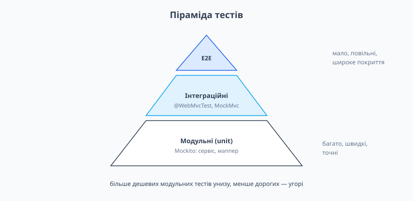
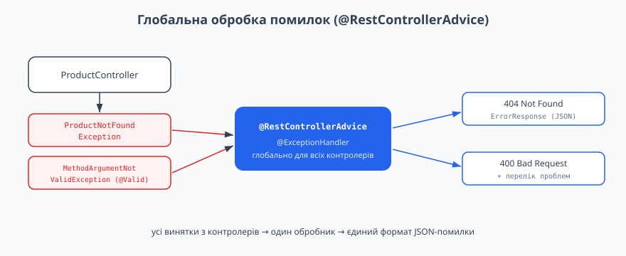

# Заняття 1.4. Тестування: модульні (Mockito) та інтеграційні (MockMvc)

**Дисципліна:** Розробка застосунків на Spring Boot
**Модуль 1:** Spring Boot без бази даних
**Тип заняття:** групове (2 год)

## Передумови

Заняття продовжує 1.1–1.3. Передбачається знайомство з багатошаровою структурою
(`web` / `service` / `repository` / `domain`), DTO та повним CRUD із заняття 1.2.

## Навчальні результати

Після заняття студент здатен:

1. пояснити різницю між модульним (unit) та інтеграційним тестами і коли який застосовувати;
2. писати модульні тести сервісу з підміною залежностей через Mockito (`@Mock`, `when`, `verify`);
3. писати інтеграційні тести веб-шару через `@WebMvcTest` і `MockMvc` з перевіркою JSON;
4. пояснити різницю між `@WebMvcTest` та `@SpringBootTest`;
5. реалізувати глобальну обробку помилок (`@RestControllerAdvice`, `@ExceptionHandler`)
   і покрити тестами відповіді `404` та `400`.

Матеріал спирається на офіційну документацію Spring (див. «Джерела»).

---

## 1. Навіщо тести і які вони бувають

**Тест** — це код, що автоматично перевіряє інший код. Він фіксує очікувану поведінку:
якщо хтось випадково її зламає (регрес), тест стане «червоним» і покаже проблему.

Тести поділяють за обсягом того, що вони перевіряють:

- **Модульний (unit) тест** перевіряє один компонент **в ізоляції** від інших. Залежності
  цього компонента підміняють «заглушками» (mock-об'єктами). Офіційна документація Spring
  рекомендує тестувати об'єкти сервісного шару, **підмінюючи (stub/mock) інтерфейси репозиторіїв,
  без доступу до реальних даних** [1].
- **Інтеграційний тест** перевіряє **взаємодію кількох компонентів** разом (напр. контролер +
  серіалізація JSON + маршрутизація запиту).



Модульних тестів зазвичай більшість (вони швидкі й точні), інтеграційних — менше (вони
повільніші, але перевіряють, що компоненти працюють разом).

---

## 2. Модульний тест сервісу з Mockito

**Mockito** — бібліотека для створення mock-об'єктів (заглушок). Mock імітує залежність:
йому задають, що повертати, і перевіряють, як його викликали.

Сервіс `ProductServiceImpl` залежить від `ProductRepository` і `ProductMapper`. Щоб
перевірити **лише логіку сервісу**, репозиторій підміняють mock-об'єктом:

```java
class ProductServiceImplTest {

    private final ProductRepository repository = mock(ProductRepository.class);
    private final ProductMapper mapper = new ProductMapper();
    private final ProductService service = new ProductServiceImpl(repository, mapper);

    @Test
    void findById_throwsWhenNotFound() {
        when(repository.findById(999L)).thenReturn(Optional.empty());  // задаємо поведінку заглушки

        assertThatThrownBy(() -> service.findById(999L))
                .isInstanceOf(ProductNotFoundException.class);
    }
}
```

Ключові операції Mockito:

- **`mock(Class)`** — створити заглушку залежності;
- **`when(...).thenReturn(...)`** — задати, що заглушка повертає на певний виклик;
- **`verify(...)`** — перевірити, що метод заглушки викликали (напр. `verify(repository).deleteById(1L)`).

Оскільки об'єкти створюються через конструктор (DI), сервіс можна зібрати в тесті вручну —
без запуску Spring. Це відповідає принципу: правильно шарований код тестується в ізоляції [1].

---

## 3. Інтеграційний тест веб-шару: `@WebMvcTest` і `MockMvc`

Контролер відповідає за HTTP: маршрутизацію, читання тіла, серіалізацію у JSON, коди
відповіді. Щоб перевірити це, недостатньо викликати метод — потрібен веб-шар Spring MVC.

**`@WebMvcTest`** піднімає **лише веб-шар** (не весь застосунок). За документацією, вона
автоконфігурує інфраструктуру Spring MVC й обмежує сканування бінами `@Controller`,
**`@ControllerAdvice`**, конвертерами тощо; звичайні `@Component`-біни не скануються [2].
Тому сервіс підміняють mock-об'єктом (`@MockBean`).

**`MockMvc`** дозволяє надсилати запити до контролера **без запуску реального HTTP-сервера** [2] —
тести швидші, бо запит обробляється на рівні Spring MVC, а не через мережу.

```java
@WebMvcTest(ProductController.class)
class ProductControllerTest {

    @Autowired private MockMvc mockMvc;
    @MockBean private ProductService productService;

    @Test
    void getOne_returnsProductDetail() throws Exception {
        when(productService.findById(1L)).thenReturn(sampleDetail());

        mockMvc.perform(get("/api/products/1"))
                .andExpect(status().isOk())
                .andExpect(jsonPath("$.id").value(1));
    }
}
```

- **`mockMvc.perform(...)`** — виконати імітований HTTP-запит;
- **`status().isOk()`** — перевірити код відповіді;
- **`jsonPath("$.id").value(1)`** — перевірити поле у JSON-відповіді.

### `@WebMvcTest` vs `@SpringBootTest`

| | `@WebMvcTest` | `@SpringBootTest` |
|---|---|---|
| Що піднімає | лише веб-шар (зріз) [2] | повний контекст застосунку [3] |
| Швидкість | швидше | повільніше |
| Коли | тест контролера ізольовано | end-to-end, кілька шарів разом |

`@SpringBootTest` створює повний `ApplicationContext` через `SpringApplication` [3] —
застосовують, коли потрібно перевірити застосунок цілком, а не окремий зріз.

---

## 4. Глобальна обробка помилок

На попередніх заняттях помилка «товар не знайдено» давала код `404`, але без єдиного
формату тіла. Тепер усі помилки API обробляються **в одному місці** й повертають
передбачуваний JSON.

**`@ExceptionHandler`**-методи обробляють винятки з методів контролера; розміщені в класі
з **`@ControllerAdvice`** (чи `@RestControllerAdvice`), вони застосовуються **глобально до
всіх контролерів** [4]. Це дозволяє зібрати обробку помилок в одному класі замість
повторення в кожному контролері.



[`GlobalExceptionHandler`](../../amazonua-gz14/src/main/java/com/ua/amazonua/web/GlobalExceptionHandler.java):

```java
@RestControllerAdvice
public class GlobalExceptionHandler {

    @ExceptionHandler(ProductNotFoundException.class)
    @ResponseStatus(HttpStatus.NOT_FOUND)
    public ErrorResponse handleNotFound(ProductNotFoundException ex) {
        return new ErrorResponse(404, "Not Found", ex.getMessage());
    }

    @ExceptionHandler(MethodArgumentNotValidException.class)
    @ResponseStatus(HttpStatus.BAD_REQUEST)
    public ErrorResponse handleValidation(MethodArgumentNotValidException ex) { ... }
}
```

### Валідація вхідних даних → `400`

На вхідний DTO додано правила перевірки (Bean Validation):
`@NotBlank` на `name`/`category`, `@Positive` на `price`. У контролері тіло позначено
`@Valid`. Якщо дані не проходять перевірку, Spring MVC кидає `MethodArgumentNotValidException` [4],
і глобальний обробник повертає `400` з переліком проблем.

Усі помилки повертаються у єдиному форматі
[`ErrorResponse`](../../amazonua-gz14/src/main/java/com/ua/amazonua/web/dto/ErrorResponse.java)
(`status`, `error`, `message`, `details`).

### Тести помилок

Оскільки `@WebMvcTest` сканує `@ControllerAdvice` [2], обробник бере участь у тесті
контролера. Покрито:

- `404` з тілом `ErrorResponse` для неіснуючого товару;
- `400` з переліком проблем для невалідного тіла запиту.

---

## 5. Запуск і перевірка

### Вимоги до середовища

Проєкт використовує **Spring Boot 3.4.13** та **Java 21**. Тести Mockito **не працюють під
новішими JDK** (напр. 25) — перед запуском слід явно вказати Java 21 через `JAVA_HOME`:
```bash
export JAVA_HOME=$(/usr/libexec/java_home -v 21)    # macOS
```

### Запуск тестів

```bash
cd amazonua-gz14
./mvnw test
```
Очікувано: усі тести зелені (модульні тести сервісу й мапера + інтеграційні тести контролера,
включно з перевіркою `404` та `400`).

### Запуск застосунку (для ручної перевірки помилок)

```bash
cd amazonua-gz14
./mvnw spring-boot:run
```
Приклади запитів, що демонструють `404` і `400`, — у файлі [`requests.md`](./requests.md).

> Якщо порт 8080 зайнятий: `lsof -i :8080` і `kill $(lsof -t -i :8080)` (macOS/Linux)
> або `netstat -ano | findstr :8080` + `taskkill /PID <PID> /F` (Windows); чи інший порт
> через `--server.port=8081`.

---

## 6. Завдання для самостійної роботи

Самостійна робота — продовження **власного проєкту** (власний репозиторій, власна сутність):
покрити його тестами й додати глобальну обробку помилок. Лише backend. Повна покрокова
інструкція та діаграми — в окремому файлі:

**→ [`gz14_student_task.md`](./gz14_student_task.md)**

Коротко очікуваний результат:
1. Модульний тест одного методу свого сервісу (Mockito).
2. Інтеграційний тест свого `GET`-ендпоінта (`@WebMvcTest` + `MockMvc`).
3. Глобальний `@RestControllerAdvice` з обробкою `404` і `400`; тести на них.
4. Зелений `./mvnw test`.

---

## Джерела

1. Spring Framework Documentation. *Testing — Unit Testing (Mock Objects).* https://docs.spring.io/spring-framework/reference/testing/unit.html
2. Spring Boot Documentation. *Testing — Auto-configured Spring MVC Tests (@WebMvcTest, MockMvc).* https://docs.spring.io/spring-boot/reference/testing/spring-boot-applications.html
3. Spring Boot Documentation. *Testing — @SpringBootTest.* https://docs.spring.io/spring-boot/reference/testing/spring-boot-applications.html
4. Spring Framework Documentation. *Web MVC — Exception Handling (@ExceptionHandler, @ControllerAdvice).* https://docs.spring.io/spring-framework/reference/web/webmvc/mvc-controller/ann-exceptionhandler.html
