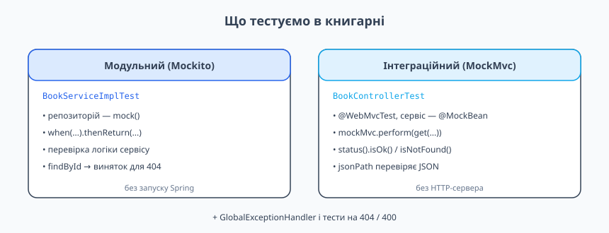

# Самостійна робота до заняття 1.4 — тести та обробка помилок (лише backend)

## Мета

Покрити **власний проєкт** із попередніх занять модульними та інтеграційними тестами
й додати глобальну обробку помилок. Лише backend, у **власному репозиторії**, на
**власній предметній області**.

Наскрізний приклад — та сама книгарня (сутність `Book`).

## Бали

Заняття **1/4 (ГЗ)** — максимум **4 бали**.

Бали виставляються за результатами **усного опитування викладача** — **4 питання по 1 балу**
за кожне. Питання стосуються **пройденого на занятті матеріалу та цієї самостійної роботи**,
наприклад: що таке піраміда тестування; що ізолює модульний тест і навіщо mock репозиторію;
роль `@WebMvcTest` і `MockMvc` в інтеграційному тесті; навіщо глобальний `@RestControllerAdvice`
та єдиний формат тіла помилки; які сценарії помилок (`404`/`400`) ви покрили тестами.

## Передумови

У вас уже є проєкт із повним CRUD (заняття 1.2): шари, DTO, ендпоінти `GET/POST/PUT/DELETE`.

---

## Що має вийти



---

## Крок 1. Модульний тест сервісу (Mockito)

Створіть `BookServiceImplTest` у `src/test/.../service/`. Репозиторій і залежності —
через `mock()`:

```java
class BookServiceImplTest {

    private final BookRepository repository = mock(BookRepository.class);
    private final BookMapper mapper = new BookMapper();
    private final BookService service = new BookServiceImpl(repository, mapper);

    @Test
    void findById_returnsBook() {
        Book book = new Book(1L, "Кобзар", "Шевченко", /* ... */);
        when(repository.findById(1L)).thenReturn(Optional.of(book));

        BookDetailDto dto = service.findById(1L);

        assertThat(dto.id()).isEqualTo(1L);
    }

    @Test
    void findById_throwsWhenNotFound() {
        when(repository.findById(999L)).thenReturn(Optional.empty());

        assertThatThrownBy(() -> service.findById(999L))
                .isInstanceOf(BookNotFoundException.class);
    }
}
```

## Крок 2. Інтеграційний тест контролера (@WebMvcTest + MockMvc)

Створіть `BookControllerTest`. Сервіс підміняється `@MockBean`:

```java
@WebMvcTest(BookController.class)
class BookControllerTest {

    @Autowired private MockMvc mockMvc;
    @MockBean private BookService bookService;

    @Test
    void list_returnsBooks() throws Exception {
        when(bookService.findAll(null)).thenReturn(List.of(
                new BookCardDto(1L, "Кобзар", "Шевченко", new BigDecimal("250"), "/covers/k.jpg")));

        mockMvc.perform(get("/api/books"))
                .andExpect(status().isOk())
                .andExpect(jsonPath("$[0].title").value("Кобзар"));
    }

    @Test
    void getOne_returns404WhenMissing() throws Exception {
        when(bookService.findById(999L)).thenThrow(new BookNotFoundException(999L));

        mockMvc.perform(get("/api/books/999"))
                .andExpect(status().isNotFound());
    }
}
```

## Крок 3. Додати залежність валідації

У `pom.xml`:
```xml
<dependency>
    <groupId>org.springframework.boot</groupId>
    <artifactId>spring-boot-starter-validation</artifactId>
</dependency>
```

У вхідному DTO (`BookRequest`) додайте правила:
```java
public record BookRequest(
        @NotBlank(message = "назва обов'язкова") String title,
        @NotBlank(message = "автор обов'язковий") String author,
        @Positive(message = "ціна має бути додатною") java.math.BigDecimal price,
        // ...
) {}
```
У контролері позначте тіло `@Valid`:
```java
@PostMapping
public BookDetailDto create(@Valid @RequestBody BookRequest request) { ... }
```

## Крок 4. Глобальна обробка помилок

Створіть `ErrorResponse` (record: `status`, `error`, `message`, `details`) і
`GlobalExceptionHandler`:

```java
@RestControllerAdvice
public class GlobalExceptionHandler {

    @ExceptionHandler(BookNotFoundException.class)
    @ResponseStatus(HttpStatus.NOT_FOUND)
    public ErrorResponse handleNotFound(BookNotFoundException ex) {
        return new ErrorResponse(404, "Not Found", ex.getMessage(), List.of());
    }

    @ExceptionHandler(MethodArgumentNotValidException.class)
    @ResponseStatus(HttpStatus.BAD_REQUEST)
    public ErrorResponse handleValidation(MethodArgumentNotValidException ex) {
        List<String> details = ex.getBindingResult().getFieldErrors().stream()
                .map(e -> e.getField() + ": " + e.getDefaultMessage()).toList();
        return new ErrorResponse(400, "Bad Request", "Помилка валідації", details);
    }
}
```

Приберіть `@ResponseStatus` з `BookNotFoundException` (тепер 404 формує обробник зі
структурованим тілом).

## Крок 5. Тести на помилки

Додайте в `BookControllerTest`:
- тест `404` з перевіркою тіла (`jsonPath("$.status").value(404)`);
- тест `400` для невалідного тіла (порожня назва / від'ємна ціна), перевірка
  `jsonPath("$.details").isArray()`.

## Крок 6. Запуск

```bash
cd <ваш-проєкт>
JAVA_HOME=$(/usr/libexec/java_home -v 21) ./mvnw test
```
Усі тести мають бути зелені.

---

## Що здати

1. У **вашому** репозиторії — модульний тест сервісу і інтеграційний тест контролера.
2. Глобальний `@RestControllerAdvice` з обробкою `404` і `400`.
3. Тести, що перевіряють структуроване тіло помилки.
4. Зелений `./mvnw test`; короткий опис у README, які сценарії покрито.

## Критерії

- Модульний тест ізолює сервіс (репозиторій — mock).
- Інтеграційний тест використовує `@WebMvcTest` + `MockMvc` + `jsonPath`.
- Усі помилки повертають єдиний формат (`ErrorResponse`).
- Предметна область власна (сутність відрізняється від еталона).
