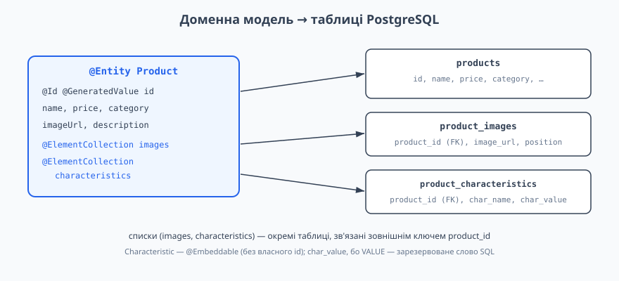
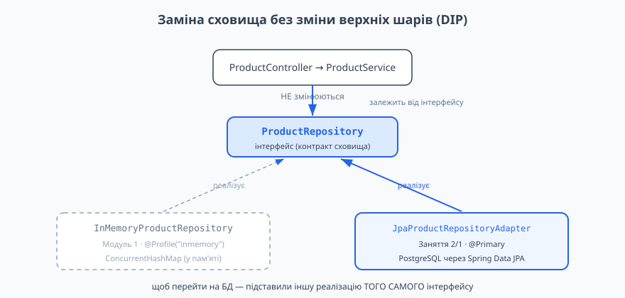
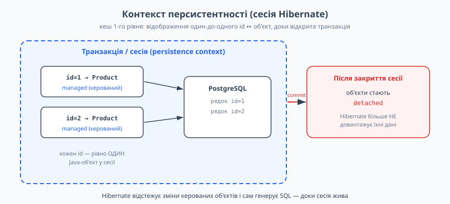
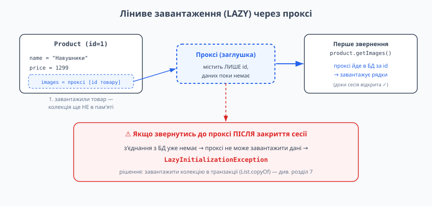
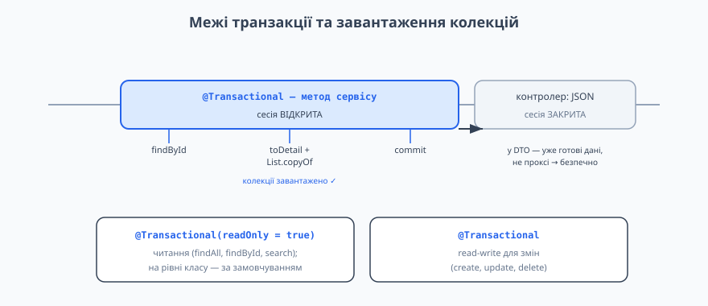
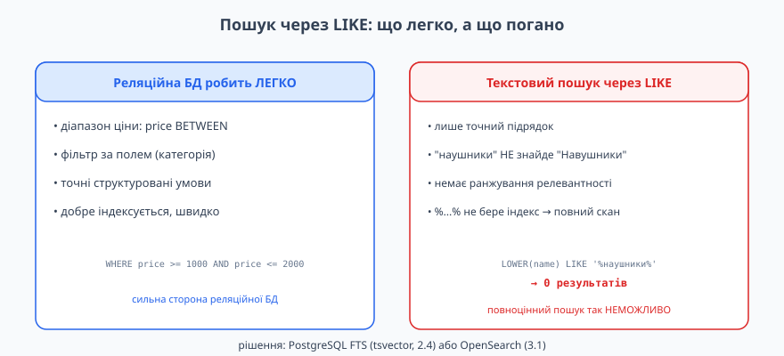
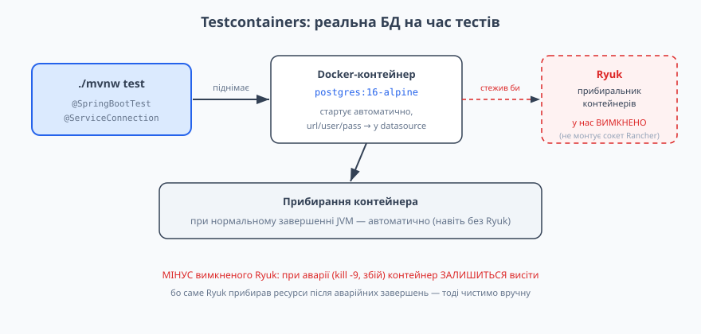

# Заняття 2.1. PostgreSQL у Docker і Spring Data JPA: від пам'яті до реальної БД

**Дисципліна:** Розробка застосунків на Spring Boot
**Модуль 2:** PostgreSQL глибше + MongoDB
**Тип заняття:** групове (2 год)

## Передумови

Заняття продовжує Модуль 1. Передбачається знайомство з багатошаровою структурою
(`web` / `service` / `repository` / `domain`), інтерфейсами на межах шарів (DIP), DTO,
повним CRUD і тестами (модульні, зрізові, наскрізні).

## Навчальні результати

Після заняття студент здатен:

1. підняти PostgreSQL у Docker через `docker-compose` і під'єднати до нього застосунок;
2. перетворити доменний клас на JPA-сутність (`@Entity`) і зберігати дані у БД;
3. замінити реалізацію репозиторію з пам'яті на БД **без зміни сервісу й контролера**
   (наочна інверсія залежностей);
4. пояснити призначення `spring.jpa.hibernate.ddl-auto` і чому в проді його не ставлять у `update`;
5. писати інтеграційні тести проти **реальної БД** через Testcontainers;
6. пояснити роль Ryuk у Testcontainers, навіщо його інколи вимикають і які це має наслідки;
7. розпізнавати й усувати типові JPA-пастки: `LazyInitializationException` і межі транзакцій.

Матеріал спирається на офіційну документацію Spring, PostgreSQL та Testcontainers (див. «Джерела»).

---

## 1. Навіщо перехід на базу даних

На Модулі 1 товари зберігались у пам'яті (`ConcurrentHashMap`). Недолік очевидний:
**після перезапуску застосунку всі дані зникають**. Реальному застосунку потрібне
**постійне сховище** — база даних, яка зберігає дані між запусками, підтримує транзакції,
паралельний доступ, запити та індекси.

У цьому модулі ми використовуємо **PostgreSQL** — одну з найпоширеніших реляційних БД.
Усі бази курсу запускаються **лише через Docker** — це дає однакове середовище у всіх і
можливість швидко підняти чи скинути БД.

---

## 2. PostgreSQL у Docker

БД піднімається описом у [`docker-compose.yml`](../../amazonua-gz21/docker-compose.yml):

```yaml
services:
  postgres:
    image: postgres:16-alpine
    environment:
      POSTGRES_DB: amazonua
      POSTGRES_USER: amazonua
      POSTGRES_PASSWORD: amazonua
    ports:
      - "5432:5432"
    volumes:
      - amazonua-pgdata:/var/lib/postgresql/data
    healthcheck:
      test: ["CMD-SHELL", "pg_isready -U amazonua -d amazonua"]
      interval: 5s
      timeout: 3s
      retries: 10
```

- **`image`** — образ БД. Використано `postgres:16-alpine` (легкий варіант на Alpine Linux).
- **`environment`** — ім'я БД, користувач, пароль (для навчання — прості; у проді — секрети).
- **`ports`** — `5432:5432` пробрасує порт контейнера на хост, щоб застосунок достукався.
- **`volumes`** — іменований том, щоб дані **пережили** перезапуск і видалення контейнера.
- **`healthcheck`** — контейнер вважається готовим лише коли БД приймає підключення.

Команди:
```bash
docker compose up -d      # підняти в фоні
docker compose down       # зупинити (дані лишаються в томі)
docker compose down -v    # зупинити й видалити том (скинути дані)
```

> **Чому саме `-alpine`.** Звичайний образ `postgres:16` (на Debian) із новими версіями
> `tzdata` **відхиляє застарілу назву часового поясу** `Europe/Kiev`, яку деякі системи
> ще передають драйверу, і з'єднання падає з `FATAL: invalid value for parameter "TimeZone"`.
> Образ `postgres:16-alpine` цю назву приймає. Коректна сучасна назва поясу — `Europe/Kyiv`.

---

## 3. Підключення застосунку до БД

### 3.1. Залежності

У `pom.xml` додано стартер Spring Data JPA (приносить Hibernate + Spring Data) та драйвер
PostgreSQL [1]:

```xml
<dependency>
    <groupId>org.springframework.boot</groupId>
    <artifactId>spring-boot-starter-data-jpa</artifactId>
</dependency>
<dependency>
    <groupId>org.postgresql</groupId>
    <artifactId>postgresql</artifactId>
    <scope>runtime</scope>
</dependency>
```

### 3.2. Налаштування `application.yaml`

```yaml
spring:
  datasource:
    url: jdbc:postgresql://localhost:5432/amazonua
    username: amazonua
    password: amazonua
  jpa:
    hibernate:
      ddl-auto: update
    open-in-view: false
```

- **`spring.datasource.*`** — адреса, користувач і пароль БД [2].
- **`spring.jpa.hibernate.ddl-auto`** — керує схемою БД (див. розділ 4).
- **`spring.jpa.open-in-view: false`** — вимикаємо OSIV (див. розділ 7.1).

---

## 4. Керування схемою: `ddl-auto`

Властивість `spring.jpa.hibernate.ddl-auto` визначає, що Hibernate робить зі схемою БД
під час старту. Можливі значення [2]:

| Значення | Дія |
|---|---|
| `none` | нічого не робити зі схемою |
| `validate` | лише перевірити, що схема відповідає сутностям; змін не вносити |
| `update` | додати нові таблиці/стовпці (наявні не видаляє) |
| `create` | створити схему, знищивши попередні дані |
| `create-drop` | створити при старті, видалити при зупинці |

На цьому занятті використано **`update`** — зручно для навчання: Hibernate сам створює
таблиці зі схеми сутностей. **Але у промисловому середовищі так не роблять:** офіційна
рекомендація — `validate` або `none` [2], а схему мають вести **міграції** (Liquibase —
заняття 2.2). Причина: автоматична зміна схеми може призвести до втрати даних або
неконтрольованих змін.

---

## 5. Доменний клас стає JPA-сутністю

Клас [`Product`](../../amazonua-gz21/src/main/java/com/ua/amazonua/domain/Product.java)
тепер позначено JPA-анотаціями, які описують, **як поля класу відображаються на таблиці БД**
(*object-relational mapping, ORM*). Hibernate читає ці анотації й сам генерує SQL.

### 5.1. Усі анотації сутності та їх призначення

```java
@Entity
@Table(name = "products")
public class Product {

    @Id
    @GeneratedValue(strategy = GenerationType.IDENTITY)
    private Long id;

    @Column(nullable = false)
    private String name;

    @Column(length = 2000)
    private String description;

    @ElementCollection
    @CollectionTable(name = "product_images", joinColumns = @JoinColumn(name = "product_id"))
    @Column(name = "image_url")
    @OrderColumn(name = "position")
    private List<String> images;

    @ElementCollection
    @CollectionTable(name = "product_characteristics", joinColumns = @JoinColumn(name = "product_id"))
    @OrderColumn(name = "position")
    private List<Characteristic> characteristics;
}
```

| Анотація | Що робить |
|---|---|
| `@Entity` | позначає клас як сутність JPA; Hibernate мапить його на таблицю. Вимагає конструктора без аргументів |
| `@Table(name = "products")` | задає ім'я таблиці (без неї — ім'я класу) |
| `@Id` | поле є первинним ключем таблиці |
| `@GeneratedValue(strategy = IDENTITY)` | значення id генерує сама БД (автоінкремент стовпця) |
| `@Column(nullable = false, length = 2000)` | налаштування стовпця: обов'язковість, довжина тощо |
| `@ElementCollection` | поле-колекція **значень** (не окремих сутностей) → зберігається в окремій таблиці |
| `@CollectionTable(name, joinColumns)` | ім'я таблиці для колекції та стовпець зовнішнього ключа на `products` |
| `@OrderColumn(name = "position")` | додає стовпець, що фіксує **порядок** елементів списку (див. 5.2) |
| `@Embeddable` | на класі `Characteristic`: вбудовуваний тип без власної таблиці/id (див. 5.3) |

### 5.2. Для чого `@OrderColumn` і стовпець `position`

Таблиця в SQL **не гарантує порядок рядків**: без `ORDER BY` БД може повернути їх у будь-якій
послідовності. Але для нас порядок **важливий**:

- у `images` перший елемент — **основне фото** (на картці), решта — галерея в заданому порядку;
- `characteristics` мають показуватись у тій послідовності, у якій їх задали.

`@OrderColumn(name = "position")` каже Hibernate зберігати індекс кожного елемента (0, 1, 2…)
в окремому стовпці `position`. При читанні Hibernate додає `ORDER BY position` і відновлює
**точно той самий порядок**, у якому список було збережено. Без цієї анотації порядок
елементів міг би «попливти» між читаннями — і основним стало б випадкове фото.

> Якщо порядок байдужий (напр. набір тегів), `@OrderColumn` не ставлять, а замість `List`
> часто беруть `Set`. Для фото й характеристик порядок має значення — тому `position` доречний.

### 5.3. Для чого `@Embeddable` на `Characteristic`

`Characteristic` — це пара «назва → значення». Вона **не самостійна сутність**: не має власного
id, не живе окремо від товару, на неї ніхто не посилається. Тому її позначено
[`@Embeddable`](../../amazonua-gz21/src/main/java/com/ua/amazonua/domain/Characteristic.java)
— **вбудовуваний тип**: не має власної таблиці/id, а зберігається у складі колекції товару.

Правило вибору:

| Ознака | Що брати |
|---|---|
| Має власний id, живе окремо, на нього посилаються | `@Entity` (своя таблиця) |
| Набір полів, що належить господарю, без власного id | `@Embeddable` |
| Список таких вбудовуваних значень | `@ElementCollection` + `@Embeddable` |

Якби `Characteristic` зробили окремою `@Entity`, довелось би керувати її id, зв'язками
(`@OneToMany`/`@ManyToOne`), каскадами — надлишково для значення, яке ніхто не використовує окремо.

У результаті структура таблиць така:



### 5.4. Як це виглядало б БЕЗ Spring Data (щоб оцінити, що він робить за нас)

Spring Data JPA генерує реалізацію репозиторію автоматично: ми лише оголошуємо інтерфейс [7].
Щоб побачити, скільки роботи він бере на себе, порівняймо **збереження одного товару**.

**З нашим адаптером на Spring Data** — один рядок:
```java
jpa.save(product);   // Spring Data сам відкриває транзакцію, генерує INSERT, керує сесією
```

**Чистий JPA (без Spring Data)** — доводиться вручну керувати `EntityManager` і транзакцією:
```java
EntityManagerFactory emf = Persistence.createEntityManagerFactory("amazonua");
EntityManager em = emf.createEntityManager();
EntityTransaction tx = em.getTransaction();
try {
    tx.begin();
    em.persist(product);   // лише сам виклик persist — решта рядків це «обв'язка»
    tx.commit();
} catch (RuntimeException e) {
    if (tx.isActive()) tx.rollback();
    throw e;
} finally {
    em.close();
}
```

**Чистий JDBC (без JPA взагалі)** — доводиться писати SQL і перекладати поля руками, ще й
окремо вставляти рядки дочірніх таблиць (`product_images`, `product_characteristics`):
```java
try (Connection con = dataSource.getConnection()) {
    con.setAutoCommit(false);
    PreparedStatement ps = con.prepareStatement(
        "INSERT INTO products(name, price, category, description, image_url) VALUES (?,?,?,?,?)",
        Statement.RETURN_GENERATED_KEYS);
    ps.setString(1, product.getName());
    ps.setBigDecimal(2, product.getPrice());
    ps.setString(3, product.getCategory());
    ps.setString(4, product.getDescription());
    ps.setString(5, product.getImageUrl());
    ps.executeUpdate();
    // дістати згенерований id, потім окремими INSERT-ами зберегти images і characteristics...
    con.commit();
}
// + вручну писати код для SELECT, читання ResultSet у об'єкти, UPDATE, DELETE...
```

Це **три рівні абстракції**, один над одним:

1. **JDBC** (найнижчий) — ви самі пишете SQL, біндите параметри, читаєте `ResultSet` у поля.
2. **JPA/Hibernate** — надбудова над JDBC: прибирає ручний SQL і мапінг; ви працюєте з
   об'єктами, а Hibernate генерує SQL і перекладає рядки ↔ сутності. Але керувати
   `EntityManager` і транзакціями доводиться вручну (приклад вище).
3. **Spring Data JPA** — надбудова над JPA: прибирає ще й ручний `EntityManager`, транзакції
   та написання класів-реалізацій репозиторію. Ви лише **оголошуєте інтерфейс**, а реалізацію
   генерує Spring Data [7].

Коли нижче в тексті написано «Spring Data **над** JPA» — мається на увазі саме цей рівень:
Spring Data не замінює JPA, а стоїть на ньому як ще один шар, що прибирає залишкову рутину.
Кожен вищий рівень менше коду, але й менше прямого контролю над SQL.

---

## 6. Заміна сховища без зміни верхніх шарів (DIP на практиці)

Це ключовий момент заняття. На Модулі 1 ми навмисно поклали на межу шарів **інтерфейс**
`ProductRepository`. Тепер це окупається: щоб перейти на БД, достатньо **підставити іншу
реалізацію того самого інтерфейсу** — сервіс і контролер **не змінюються**.



Нова реалізація складається з двох частин:

- [`ProductJpaRepository`](../../amazonua-gz21/src/main/java/com/ua/amazonua/repository/jpa/ProductJpaRepository.java)
  — репозиторій Spring Data (успадковує `JpaRepository<Product, Long>`); готові методи
  (`findAll`, `save`, `deleteById`…) генерує сам Spring Data. `findByCategoryIgnoreCase`
  — derived query (SQL будується за назвою методу).
- [`JpaProductRepositoryAdapter`](../../amazonua-gz21/src/main/java/com/ua/amazonua/repository/jpa/JpaProductRepositoryAdapter.java)
  — **адаптер**: реалізує наш доменний `ProductRepository`, делегуючи до Spring Data.

### 6.1. Навіщо `@Primary`

Тепер у застосунку є **дві** реалізації інтерфейсу `ProductRepository`: нова JPA-адаптер і
стара in-memory. Коли сервіс просить впровадити `ProductRepository`, Spring бачить **двох
кандидатів** — і за замовчуванням не знає, кого обрати (виникла б помилка неоднозначності).

Анотація **`@Primary`** знімає цю неоднозначність: вона вказує, що **цей бін слід надавати
перевагу, коли на одну залежність претендують кілька кандидатів** [8]. Ми ставимо `@Primary`
на JPA-адаптер — і саме він впроваджується в сервіс як основна реалізація.

Стара [`InMemoryProductRepository`](../../amazonua-gz21/src/main/java/com/ua/amazonua/repository/InMemoryProductRepository.java)
при цьому не конфліктує, бо позначена `@Profile("inmemory")` — тобто стає біном **лише** під
профілем `inmemory`. За замовчуванням її взагалі немає в контексті, тож активний лише
JPA-адаптер. Щоб повернутись до пам'яті, достатньо запустити з
`--spring.profiles.active=inmemory` — тоді активується in-memory, а JPA-реалізація вимкнеться,
і **жоден інший клас не зміниться**.

**Висновок:** сервіс і контролер залежать від **контракту** (`ProductRepository`), а не від
реалізації — тому зміна сховища їх не торкнулась. Це і є практична користь інверсії
залежностей.

---

## 7. Типові JPA-пастки (і як ми їх усунули)

Перехід на JPA приносить два класичні підводні камені, на яких варто спинитись. Щоб їх
зрозуміти, спершу треба знати два поняття Hibernate: **контекст персистентності** й **проксі
лінивого завантаження**.

### 7.1. Контекст персистентності (сесія) і ліниве завантаження

**Контекст персистентності** (*persistence context*, він же **сесія** Hibernate) — це
внутрішній кеш першого рівня. За описом Hibernate, його можна розглядати як **відображення
один-до-одного між ідентифікаторами (id) та екземплярами сутностей** у пам'яті: у межах однієї
сесії кожен рядок БД представлено рівно одним Java-об'єктом [9]. Об'єкти, завантажені в
контекст, стають **керованими** (*managed*): Hibernate відстежує зміни їх стану й сам генерує
потрібний SQL [9].

Сесія живе в межах **транзакції**. Коли транзакція завершується, сесія закривається, і
керовані об'єкти стають «відірваними» (*detached*) — Hibernate більше не може їх довантажувати.



**Ліниве завантаження (LAZY) і проксі.** Пов'язані дані (колекції, зв'язки) за замовчуванням
завантажуються **ліниво** — не одразу з сутністю, а за потреби. Замість реальних даних
Hibernate кладе **проксі (заглушку), що містить лише ідентифікатор** потрібних даних; самі
дані підвантажуються **при першому зверненні** до проксі [9]. Саме так lazy-колекція
«тримає id, щоб потім отримати дані»: доки до неї не звернулись — у пам'яті лише посилання/id,
а похід у БД відкладається до моменту реального доступу.

Проблема: довантажити дані проксі може **лише доки відкрита сесія** (є з'єднання з БД). Якщо
звернутись до лінивого проксі **після** закриття сесії — похід у БД зробити нікуди, і
виникає **`LazyInitializationException`** [9].



### 7.2. `LazyInitializationException` і межі транзакції

За замовчуванням `@ElementCollection` **ліниве** (LAZY): колекція (`images`,
`characteristics`) у завантаженому товарі — це проксі з ідентифікатором (див. 7.1); реальні
рядки з таблиць `product_images`/`product_characteristics` підтягнуться лише при зверненні.
Звернутись можна **лише доки відкрита сесія** (транзакція). Якщо сесія закрита —
**`LazyInitializationException`**.

Ми навмисно вимкнули **OSIV** (`open-in-view: false`). OSIV (*Open Session In View*) —
механізм, що тримає сесію відкритою на весь HTTP-запит; його вважають антипатерном, бо він
маскує проблему й тримає з'єднання з БД надто довго. Вимкнувши його, ми мусимо завантажувати
все потрібне **в межах транзакції сервісу**.

Рішення — зробити методи сервісу транзакційними
([`ProductServiceImpl`](../../amazonua-gz21/src/main/java/com/ua/amazonua/service/ProductServiceImpl.java)):

```java
@Service
@Transactional(readOnly = true)      // сесія відкрита на час методу → колекції встигають завантажитись
public class ProductServiceImpl implements ProductService {

    @Override
    @Transactional                   // read-write для методів, що змінюють дані
    public ProductDetailDto create(ProductRequest request) { ... }
}
```

Але самого `@Transactional` замало. `mapper.toDetail` виконується **в межах** транзакції, та
якщо він покладе у DTO **сам проксі колекції** (`product.getImages()` як є), то реальне читання
даних відбудеться **пізніше** — під час JSON-серіалізації у контролері, уже **поза** сесією →
`LazyInitializationException`. Тому маппер **матеріалізує** колекцію — **форсує завантаження
проксі ще в транзакції**, скопіювавши дані в новий звичайний список:

```java
List<String> images = product.getImages() == null ? List.of() : List.copyOf(product.getImages());
```

`List.copyOf(...)` перебирає елементи — а це і є те «перше звернення», що змушує проксі
сходити в БД, доки сесія ще відкрита. У DTO потрапляє звичайний список із уже завантаженими
даними, не прив'язаний до сесії, — і серіалізація поза транзакцією вже безпечна.



> Транзакції докладно — на занятті 2.6. Тут вони введені в мінімальному обсязі, бо без них
> робота з лінивими колекціями неможлива.

---

## 8. Фільтри та пошук: що реляційна БД робить легко, а що — погано

Тепер, коли дані в БД, додамо до переліку товарів **панель фільтрів** (категорія, діапазон
ціни) і **пошуковий рядок**. Це гарна нагода показати **межу реляційного підходу**: прості
фільтри робляться легко, а повноцінний текстовий пошук — ні.

### 8.1. Ендпоінт пошуку/фільтра

Усі критерії опційні; порожній критерій не застосовується (патерн `(:param IS NULL OR ...)`):

```
GET /api/products?category=...&minPrice=...&maxPrice=...&q=...
```

Реалізовано одним JPQL-запитом у
[`ProductJpaRepository.search`](../../amazonua-gz21/src/main/java/com/ua/amazonua/repository/jpa/ProductJpaRepository.java):

```java
@Query("""
    SELECT p FROM Product p
    WHERE (:categoryPattern IS NULL OR LOWER(p.category) LIKE CAST(:categoryPattern AS string))
      AND (:minPrice IS NULL OR p.price >= :minPrice)
      AND (:maxPrice IS NULL OR p.price <= :maxPrice)
      AND (:qPattern IS NULL OR LOWER(p.name) LIKE CAST(:qPattern AS string))
    ORDER BY p.id
    """)
List<Product> search(...);
```

### 8.2. Що реляційна БД робить ЛЕГКО

- **Діапазон ціни** — звичайне порівняння чисел `price >= :min AND price <= :max`. Точно, швидко,
  добре індексується.
- **Фільтр за категорією** — порівняння/`LIKE` по полю. Для точних значень — ідеально.

Це сильна сторона реляційної БД: **структуровані, точні умови** над полями.

### 8.3. Що реляційна БД робить ПОГАНО — текстовий пошук через `LIKE`

Текстовий пошук за назвою зроблено через SQL **`LIKE`** з шаблоном `%текст%` (*wildcards* —
`%` означає «будь-яка послідовність символів»). Патерн будується в адаптері:

```java
String qPattern = q == null ? null : "%" + q.toLowerCase() + "%";   // wildcards навколо тексту
```

`LIKE '%миша%'` знаходить рядки, де в назві **є підрядок «миша»**. Для демонстрації цього
достатньо, але як **повноцінний пошук це примітив** — і ось чому:

- **Шукає лише точний підрядок, буква-в-букву.** Запит «наушники» (одруківка) **не знайде**
  «Навушники» — LIKE не розуміє помилок. Так само не знайде за словоформою чи синонімом.
- **Не ранжує за релевантністю.** Результати не впорядковані «наскільки добре збіглося» —
  лише ті, де є/немає підрядок.
- **Повільний на обсягах.** `LIKE '%...%'` (із `%` на початку) **не може використати звичайний
  індекс** — БД робить повний скан таблиці. На мільйонах рядків це неприйнятно.

Інтеграційний тест прямо це фіксує
([`ProductApiIntegrationTest`](../../amazonua-gz21/src/test/java/com/ua/amazonua/web/ProductApiIntegrationTest.java)):
точний підрядок `бездрот` → знайдено; одруківка `наушники` → **0 результатів**.

**Висновок:** повноцінний повнотекстовий пошук (словоформи, помилки, релевантність, швидкість)
у реляційній БД через `LIKE` зробити **по-людськи неможливо**. Правильні рішення:
- **повнотекстовий пошук PostgreSQL** (`tsvector`/`tsquery`, GIN-індекс) — заняття 2.4;
- **пошуковий рушій OpenSearch** — заняття 3.1.



### 8.4. Випадаючий список категорій: окремий ендпоінт-колекція

Поле «Категорія» у панелі фільтрів — не вільний текст, а **випадаючий список (dropdown)** із
категорій, що **реально є в базі**. Щоб клієнт міг його наповнити, додано окремий ендпоінт, що
повертає **унікальні відсортовані** категорії:

```
GET /api/products/categories
```

Запит по БД — `DISTINCT` із сортуванням
([`ProductJpaRepository`](../../amazonua-gz21/src/main/java/com/ua/amazonua/repository/jpa/ProductJpaRepository.java)):

```java
@Query("SELECT DISTINCT p.category FROM Product p WHERE p.category IS NOT NULL ORDER BY p.category")
List<String> findDistinctCategories();
```

Цей запит проходить **тим самим ланцюгом DIP**, що й решта: інтерфейс
[`ProductRepository.findCategories()`](../../amazonua-gz21/src/main/java/com/ua/amazonua/repository/ProductRepository.java)
→ адаптер над Spring Data (у профілі БД) **або** `InMemoryProductRepository` (у профілі
`inmemory`, де `distinct().sorted()` робиться в пам'яті) → сервіс → контролер. Верхні шари про
реалізацію не знають.

**Важливо — порядок маршрутів у контролері.** Ендпоінт `/categories` оголошено **ПЕРЕД**
`/{id}`:

```java
@GetMapping("/categories")          // має йти ПЕРШИМ
public List<String> categories() { ... }

@GetMapping("/{id}")                // інакше перехопить і "categories"
public ProductDetailDto getOne(@PathVariable Long id) { ... }
```

Spring MVC зіставляє конкретні шаблони раніше за змінні, тож тут порядок у коді не є строго
обов'язковим, — але записувати **конкретний** маршрут перед **параметризованим** `/{id}` — це
правило, що робить намір явним і убезпечує від випадку, коли `categories` потрапив би у `{id}`
(і далі — спроба розпарсити рядок як `Long`).

### 8.5. Чому поле `category` тепер і в `ProductDetailDto`

Щоб форма **редагування** на UI могла показати поточну категорію товару, її має повертати
ендпоінт деталей `GET /api/products/{id}`. Тому поле `category` додано до
[`ProductDetailDto`](../../amazonua-gz21/src/main/java/com/ua/amazonua/web/dto/ProductDetailDto.java)
(а маппер — `ProductMapper.toDetail` — його заповнює).

Це загальне правило проєктування DTO: **detail-DTO має містити всі поля, які клієнту потрібні,
щоб відредагувати сутність.** Якщо форма редагує поле `X`, то `GET /{id}` зобов'язаний його
повертати — інакше при відкритті форми це поле «порожнє», хоча в базі значення є. Картковий
`ProductCardDto` (для переліку) навмисно вужчий — у списку категорія не потрібна, тож її там
немає. Різні сценарії — різні DTO (принцип: DTO відповідає потребам конкретного екрана).

### 8.6. Клієнтська частина

У переліку товарів (`amazonua-ui-gz21`) додано **пошуковий рядок** і **кнопку «Фільтри»**, що
відкриває панель (категорія — випадаючий список із `GET /api/products/categories`, ціна від/до).
Клієнт збирає параметри й надсилає їх у той самий ендпоінт переліку через `URLSearchParams`
(який коректно кодує кирилицю в URL). Список категорій перечитується після створення, редагування
чи видалення товару — щоб dropdown лишався актуальним. Принцип взаємодії — той самий, що раніше
(відносні шляхи + проксі середовища розробки).

---

## 9. Інтеграційні тести проти реальної БД: Testcontainers

Модульні тести (Mockito) і зрізові (`@WebMvcTest`) не торкаються БД. Але наскрізний тест
(`@SpringBootTest`) тепер працює з реальною базою — і тут важливо тестувати проти **справжнього
PostgreSQL**, а не його замінника (напр. H2), бо діалекти SQL і поведінка відрізняються.

**Testcontainers** — бібліотека, що піднімає потрібні сервіси (БД, черги тощо) у **Docker-
контейнерах на час тестів** і сама їх зупиняє. Так кожен прогін тестів іде проти реальної
БД тієї ж версії, що й прод, без ручного налаштування.



### 8.1. Налаштування

[`TestcontainersConfiguration`](../../amazonua-gz21/src/test/java/com/ua/amazonua/TestcontainersConfiguration.java):

```java
@TestConfiguration(proxyBeanMethods = false)
public class TestcontainersConfiguration {

    @Bean
    @ServiceConnection
    PostgreSQLContainer<?> postgresContainer() {
        return new PostgreSQLContainer<>("postgres:16-alpine");
    }
}
```

- **`PostgreSQLContainer`** — контейнер із PostgreSQL; стартує й зупиняється автоматично.
- **`@ServiceConnection`** — Spring Boot **сам** прокидає url/username/password контейнера у
  datasource застосунку [3]. Ручна конфігурація не потрібна.

Наскрізний тест під'єднує цю конфігурацію через `@Import(TestcontainersConfiguration.class)`.
Контролер, сервіс і DTO при цьому **ті самі**, що з in-memory — змінилась лише реалізація
репозиторію. Тож цей тест тепер перевіряє роботу з **реальним Postgres**.

---

## 10. Ryuk: прибиральник контейнерів (і що дає його вимкнення)

Це важлива тема — вона стосується **надійності та чистоти тестового середовища**.

### 9.1. Що таке Ryuk

Коли тести піднімають контейнери, їх треба **гарантовано прибрати** після завершення —
навіть якщо тестовий процес **впав або завис**. Для цього Testcontainers запускає окремий
службовий контейнер — **Ryuk** (*resource reaper*, «прибиральник ресурсів»). Ryuk відстежує
всі створені контейнери, мережі й томи (за міткою `org.testcontainers=true`) і **видаляє їх**,
коли тестова сесія завершується [4][5].

Ключова цінність Ryuk — він прибирає ресурси **навіть при аварійному завершенні** тестів:
якщо JVM «вбито» або тест завис, Ryuk усе одно зачистить контейнери, щоб Docker-середовище
не засмічувалось [4].

### 9.2. Чому ми його вимкнули

Ryuk, щоб керувати контейнерами, монтує **Docker-сокет**. На **Rancher Desktop** це
монтування не дозволене за шляхом сокета Rancher — Ryuk падає з помилкою:

```
error while creating mount source path '/Users/.../.rd/docker.sock':
operation not supported
```

Тому Ryuk вимкнено. Зроблено це **на рівні проєкту** (у `pom.xml`, через surefire-плагін),
щоб не залежати від глобальних налаштувань чи IDE:

```xml
<plugin>
    <groupId>org.apache.maven.plugins</groupId>
    <artifactId>maven-surefire-plugin</artifactId>
    <configuration>
        <environmentVariables>
            <TESTCONTAINERS_RYUK_DISABLED>true</TESTCONTAINERS_RYUK_DISABLED>
        </environmentVariables>
    </configuration>
</plugin>
```

Коли `TESTCONTAINERS_RYUK_DISABLED=true`, Testcontainers **не запускає Ryuk** і не позначає
ресурси міткою для прибирання [5].

### 9.3. Які мінуси це дає

Вимкнення Ryuk — **свідомий компроміс**, і його наслідки треба розуміти:

- **Втрачається «страхувальна сітка» при аварії.** Без Ryuk прибирання контейнерів
  відбувається **на нормальному завершенні JVM**. Але якщо процес **примусово вбито**
  (`kill -9`, збій), контейнери **залишаться висіти** — Testcontainers не встигне їх зняти [6].
- **За нормального завершення все гаразд.** Документація прямо вказує: *Testcontainers
  продовжує прибирання при завершенні JVM, якщо тільки ви не вб'єте процес через `kill -9`* [6].
  Тобто при звичайному завершенні тестів контейнери все одно зупиняються — просто без Ryuk.
- **Можливе накопичення контейнерів** при частих аварійних зупинках під час розробки — їх
  доведеться періодично чистити вручну (`docker ps -a`, `docker rm`).

> Висновок: вимикати Ryuk допустимо там, де середовище саме прибирає ресурси (ефемерні
> CI-раннери) або де Ryuk не може запуститись (Rancher). Але варто пам'ятати: ми втратили
> автоматичне прибирання після **аварійних** завершень і за потреби чистимо контейнери самі.

---

## 11. Запуск і перевірка

### Вимоги до середовища

- **Java 21** (тести Mockito не працюють під новішими JDK — вкажіть `JAVA_HOME`).
- Запущений **Docker** (Rancher Desktop / Docker Desktop) — потрібен і для БД, і для тестів.

### Підняти БД і застосунок

```bash
cd amazonua-gz21
docker compose up -d          # підняти PostgreSQL
./mvnw spring-boot:run        # запустити застосунок (під Java 21)
```
Перевірка персистентності: створіть товар, перезапустіть застосунок — товар **лишиться**
(на відміну від in-memory).

### Тести (проти реального Postgres через Testcontainers)

```bash
cd amazonua-gz21
./mvnw test
```
Ryuk вимкнено в `pom.xml`, тож окремі змінні оточення **не потрібні**. Усі тести зелені,
інтеграційні — проти контейнера PostgreSQL.

Приклади запитів і команди `psql` — у файлі [`requests.md`](./requests.md).

---

## 12. Завдання для самостійної роботи

Самостійна робота — перенесення **власної сутності** на PostgreSQL. Повна покрокова
інструкція та діаграми — в окремому файлі:

**→ [`gz21_student_task.md`](./gz21_student_task.md)**

Коротко очікуваний результат:
1. Підняти PostgreSQL у Docker (`docker-compose.yml`).
2. Перетворити свою сутність на `@Entity`; замінити in-memory репозиторій на JPA-реалізацію
   за тим самим інтерфейсом.
3. Переконатися, що дані переживають перезапуск; знайти рядок у БД через `psql`.
4. Налаштувати інтеграційний тест через Testcontainers.

---

## Джерела

1. Spring Boot Documentation. *Data — SQL Databases (spring-boot-starter-data-jpa).* https://docs.spring.io/spring-boot/reference/data/sql.html
2. Spring Boot Documentation. *Data — spring.jpa.hibernate.ddl-auto та datasource.* https://docs.spring.io/spring-boot/reference/data/sql.html
3. Spring Boot Documentation. *Testcontainers support (@ServiceConnection).* https://docs.spring.io/spring-boot/reference/features/dev-services.html
4. Testcontainers. *Reusable Containers & Automatic Cleanup (Ryuk).* https://java.testcontainers.org/
5. Testcontainers. *Custom configuration (TESTCONTAINERS_RYUK_DISABLED).* https://java.testcontainers.org/features/configuration/
6. PostgreSQL Documentation. *Date/Time types and time zones.* https://www.postgresql.org/docs/current/datatype-datetime.html
7. Spring Data JPA Documentation. *Getting Started — репозиторії без ручної реалізації.* https://docs.spring.io/spring-data/jpa/reference/jpa/getting-started.html
8. Spring Framework Documentation. *Core — @Primary (вибір біна при кількох кандидатах).* https://docs.spring.io/spring-framework/reference/core/beans/annotation-config/autowired-primary.html
9. Hibernate ORM Documentation. *Introduction — Persistence Context, Lazy Loading & Proxies.* https://docs.hibernate.org/orm/6.6/introduction/html_single/Hibernate_Introduction.html
