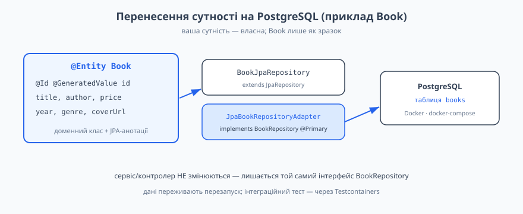

# Самостійна робота до заняття 2.1 — перенесення сутності на PostgreSQL

## Мета

Перенести **власну сутність** (ту, яку ви ведете з Модуля 1) з пам'яті у **PostgreSQL** —
за тим самим патерном, що показано на занятті для товарів. Лише backend, у **власному
репозиторії**. Наскрізний приклад — книгарня (`Book`).

## Бали

Заняття **2/1 (ГЗ)** — максимум **4 бали**.

Бали виставляються за результатами **усного опитування викладача** — **4 питання по 1 балу**
за кожне. Питання стосуються **пройденого на занятті матеріалу та цієї самостійної роботи**,
наприклад: як заміна сховища (in-memory → JPA) не торкнулась сервісу/контролера завдяки DIP;
призначення JPA-анотацій сутності (`@Entity`, `@Id`, `@GeneratedValue` тощо); що таке контекст
персистентності (сесія) і транзакції; чому виникає `LazyInitializationException` і як її усунено;
навіщо Testcontainers і як влаштований ваш інтеграційний тест проти реальної БД.

## Передумови

У вас є проєкт із Модуля 1: власна сутність, повний CRUD, шари з інтерфейсами, тести.

---

## Що має вийти



Після роботи:
- дані **переживають перезапуск** застосунку;
- сервіс і контролер **не змінились** — лише реалізація репозиторію;
- інтеграційний тест іде проти реального Postgres через Testcontainers.

---

## Крок 1. Підняти PostgreSQL у Docker

Створіть `docker-compose.yml` зі своєю БД (ім'я/користувач/пароль — власні). **Образ беріть
`postgres:16-alpine`** (звичайний `postgres:16` може відхиляти часовий пояс `Europe/Kiev`).
Додайте том (щоб дані зберігались) і healthcheck.

```bash
docker compose up -d
```

> Підказка: орієнтуйтесь на `amazonua-gz21/docker-compose.yml`.

## Крок 2. Додати залежності

У `pom.xml`:
```xml
<dependency>
    <groupId>org.springframework.boot</groupId>
    <artifactId>spring-boot-starter-data-jpa</artifactId>
</dependency>
<dependency>
    <groupId>org.postgresql</groupId>
    <artifactId>postgresql</artifactId>
    <scope>runtime</scope>
</dependency>
```

## Крок 3. Налаштувати підключення

У `application.yaml`:
```yaml
spring:
  datasource:
    url: jdbc:postgresql://localhost:5432/<ваша_бд>
    username: <user>
    password: <pass>
  jpa:
    hibernate:
      ddl-auto: update        # для навчання; у проді — validate/none + міграції
    open-in-view: false       # вимикаємо OSIV
```

## Крок 4. Перетворити сутність на @Entity

Позначте свій доменний клас JPA-анотаціями:
```java
@Entity
@Table(name = "books")
public class Book {
    @Id
    @GeneratedValue(strategy = GenerationType.IDENTITY)
    private Long id;

    @Column(nullable = false)
    private String title;
    // ... решта полів
}
```
Якщо є списки — через `@ElementCollection` (окрема таблиця). Вбудовувані типи — `@Embeddable`.
Пам'ятайте про зарезервовані слова SQL (`value`, `order`…) — задавайте їм інші імена колонок.

## Крок 5. Замінити репозиторій (DIP)

Додайте Spring Data репозиторій і адаптер до вашого інтерфейсу:
```java
public interface BookJpaRepository extends JpaRepository<Book, Long> {
    List<Book> findByGenreIgnoreCase(String genre);
}
```
```java
@Repository
@Primary
public class JpaBookRepositoryAdapter implements BookRepository {
    private final BookJpaRepository jpa;
    // конструктор + делегування всіх методів BookRepository до jpa
}
```
In-memory реалізацію лишіть під `@Profile("inmemory")` (щоб не конфліктувала).
**Сервіс і контролер не чіпайте** — у цьому сенс заняття.

## Крок 6. Транзакції для лінивих колекцій

Якщо є `@ElementCollection` (ліниві за замовчуванням) і OSIV вимкнено — позначте сервіс
`@Transactional(readOnly = true)` (а змінювальні методи — `@Transactional`), і матеріалізуйте
колекції в мапері (`List.copyOf(...)`), інакше буде `LazyInitializationException`.

## Крок 7. Перевірити персистентність

```bash
./mvnw spring-boot:run          # під Java 21
# створити запис через curl, перезапустити, переконатися що лишився
docker exec -it <контейнер> psql -U <user> -d <бд> -c "SELECT * FROM books;"
```

## Крок 8. Інтеграційний тест через Testcontainers

Додайте залежності (`spring-boot-testcontainers`, `testcontainers:junit-jupiter`,
`testcontainers:postgresql`), конфіг із `@ServiceConnection PostgreSQLContainer`
(`postgres:16-alpine`) і підключіть його до `@SpringBootTest` через `@Import`.

> На Rancher Desktop вимкніть Ryuk (`TESTCONTAINERS_RYUK_DISABLED=true` у surefire-плагіні
> `pom.xml`) — Ryuk не може змонтувати сокет Rancher. Пам'ятайте про мінус: при аварійному
> завершенні (`kill -9`) контейнери доведеться чистити вручну.

---

## Що здати

1. `docker-compose.yml` з вашою БД (образ `-alpine`).
2. Сутність як `@Entity`; JPA-реалізація репозиторію за тим самим інтерфейсом; сервіс/
   контролер без змін.
3. Доказ персистентності (запис лишається після перезапуску; скрін/лог рядка з `psql`).
4. Інтеграційний тест через Testcontainers — зелений.

## Критерії

- Дані зберігаються в PostgreSQL і переживають перезапуск.
- Зміна сховища не торкнулась сервісу/контролера (DIP).
- Немає `LazyInitializationException` (транзакції на місці).
- Усе піднімається з Docker.
