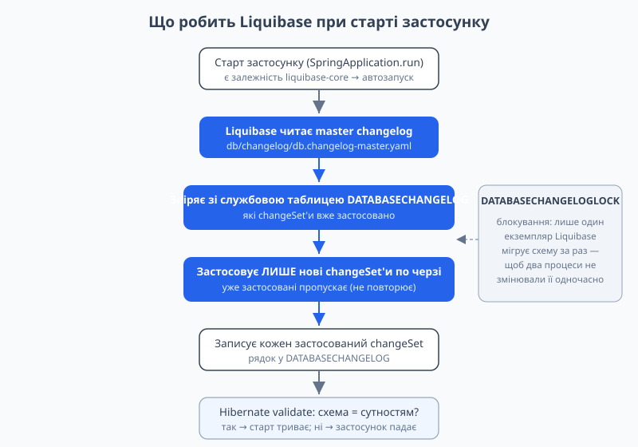
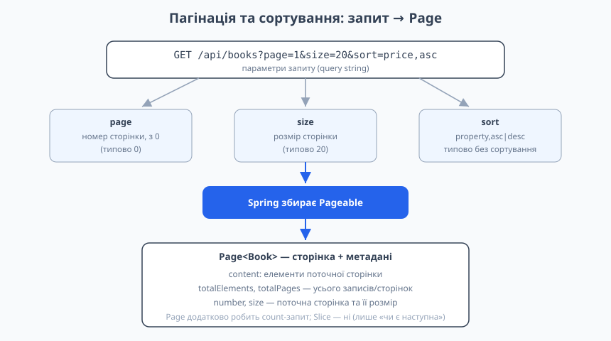
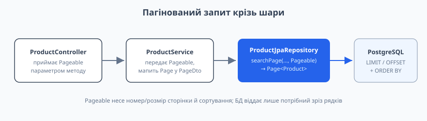

# Заняття 2.2. Міграції схеми (Liquibase); пагінація і сортування; VIEW/функції оглядово

**Дисципліна:** Розробка застосунків на Spring Boot
**Модуль 2:** Робота з базами даних (PostgreSQL глибше)
**Тип заняття:** групове (2 год)

## Передумови

Заняття продовжує 2.1. Передбачається, що ви знайомі з підключенням застосунку до
PostgreSQL через Spring Data JPA, доменною моделлю як `@Entity`, запуском БД у Docker і
інтеграційними тестами на Testcontainers. Код цього заняття — приріст до застосунку 2.1.

## Навчальні результати

Після заняття студент здатен:

1. пояснити, чому схему бази даних ведуть окремими міграціями, а не генерацією з коду
   (`ddl-auto`);
2. підключити Liquibase до застосунку Spring Boot і вказати головний файл набору змін;
3. описати, що таке набір змін (*changelog*), окрема зміна (*changeset*) та службові таблиці
   `DATABASECHANGELOG` і `DATABASECHANGELOGLOCK`;
4. написати міграцію створення таблиць (`createTable`) і міграцію початкових даних (`insert`);
5. пояснити режим `ddl-auto: validate` і його роль поряд з міграціями;
6. реалізувати пагінацію і сортування переліку (`Pageable`, `Page<T>`, параметри
   `?page=&size=&sort=`) і пояснити, навіщо вони;
7. мати уявлення (оглядово) про SQL-view (VIEW) і збережену функцію та їх створення
   міграцією Liquibase.

Матеріал спирається на офіційну документацію Spring Boot, Spring Data JPA, Liquibase та
PostgreSQL (див. «Джерела»).

---

## 1. Навіщо міграції замість `ddl-auto`

На занятті 2.1 таблиці створював Hibernate у режимі `ddl-auto: update`: він дивився на
`@Entity`-класи й сам змінював схему бази даних під них. Для перших кроків це зручно, але
для реального застосунку такий підхід має суттєві вади:

- **Немає історії змін.** Схема «виникає» зі стану класів; не видно, коли й що змінилося.
- **Немає відкату (rollback).** Якщо зміна виявилась помилковою, немає зафіксованого кроку,
  який можна скасувати.
- **Зміни неявні й ризиковані.** `update` може мовчки не застосувати потрібну зміну або
  застосувати не ту; на проді це небезпечно.

Рішення — **міграції схеми**: кожна зміна структури бази даних описується окремим кроком,
кроки нумеруються й зберігаються у проєкті під контролем версій, застосовуються по черзі й
фіксуються. Саме це робить **Liquibase**.


---

## 2. Що таке Liquibase: changelog, changeset і службові таблиці

**Liquibase** — інструмент керування змінами схеми бази даних. Опис змін зберігається у
**текстовому файлі набору змін** (*changelog*), який, за визначенням документації, «послідовно
перелічує всі зміни, внесені до бази даних» [1]. Файл набору змін виступає журналом, за яким
Liquibase виконує ще не застосовані зміни.

Окрему одиницю зміни в наборі називають **changeset** [1]. Кожен changeset має атрибути `id`
та `author`; разом зі шляхом та іменем файлу вони утворюють унікальний ідентифікатор зміни [1].

Щоб знати, які зміни вже застосовано, Liquibase веде дві службові таблиці прямо в базі:

- **`DATABASECHANGELOG`** — Liquibase використовує її, «щоб відстежувати, які зміни вже
  розгорнуто» [2]. Завдяки цьому той самий changeset не застосовується повторно: при кожному
  запуску Liquibase виконує лише нові changeset'и.
- **`DATABASECHANGELOGLOCK`** — Liquibase використовує її, «щоб гарантувати, що одночасно
  працює лише один екземпляр Liquibase» [3]. Це блокування не дає двом процесам змінювати
  схему одночасно (важливо, коли застосунок запущено в кількох копіях).

---

## 3. Підключення Liquibase до застосунку

### 3.1. Залежність

Для автоматичного запуску міграцій Liquibase під час старту до класового шляху (classpath)
додають залежність `org.liquibase:liquibase-core` [4]:

```xml
<dependency>
    <groupId>org.liquibase</groupId>
    <artifactId>liquibase-core</artifactId>
</dependency>
```

Версію залежності визначає батьківський специфікатор залежностей Spring Boot, тому номер
версії не вказують. Коли ця залежність є у проєкті, міграції Liquibase виконуються за
замовчуванням як під час старту застосунку, так і перед запуском тестів [4].

> Примітка щодо версії Spring Boot. Окремий стартер `spring-boot-starter-liquibase`
> з'явився лише у Spring Boot 3.5. Курс зафіксовано на **3.4.x**, тому тут підключають саме
> `org.liquibase:liquibase-core` [4].

### 3.2. Головний файл набору змін

За замовчуванням головний файл набору змін читається зі шляху
`db/changelog/db.changelog-master.yaml`; змінити розташування можна властивістю
`spring.liquibase.change-log` [4]. У проєкті цей шлях задано явно (щоб документувати
розташування), хоча значення й збігається з типовим:

```yaml
spring:
  liquibase:
    change-log: classpath:db/changelog/db.changelog-master.yaml
```

### 3.3. `ddl-auto: validate`

Оскільки схему тепер створює Liquibase, Hibernate більше не повинен її змінювати. Тому режим
перемкнено з `update` на **`validate`**:

```yaml
spring:
  jpa:
    hibernate:
      ddl-auto: validate
```

У режимі `validate` Hibernate не створює й не змінює таблиці, а лише **перевіряє**, що наявна
схема відповідає `@Entity`-класам. Якщо таблиця або колонка не збігається з очікуваною —
застосунок не стартує. Так єдиним джерелом схеми лишаються міграції, а `validate` слугує
запобіжником: сутності та реальна схема не розійдуться непомітно.

---

## 4. Структура набору змін

Набір змін організовано так: головний файл лише **підключає** (`include`) окремі файли змін
по черзі. Кожен файл — одна зрозуміла зміна; історія лишається читабельною.


Головний файл
[`db.changelog-master.yaml`](../../amazonua-gz22/src/main/resources/db/changelog/db.changelog-master.yaml):

```yaml
databaseChangeLog:
  - include:
      file: db/changelog/changes/001-create-products.yaml   # таблиці
  - include:
      file: db/changelog/changes/002-seed-products.yaml      # перші 4 товари
  - include:
      file: db/changelog/changes/003-view-and-function.yaml  # VIEW + функція (оглядово)
  - include:
      file: db/changelog/changes/004-seed-more-products.yaml # ще 8 товарів
  - include:
      file: db/changelog/changes/005-discounted-view-with-image.yaml # VIEW + image_url
  - include:
      file: db/changelog/changes/006-seed-even-more-products.yaml # +28 товарів (разом ~40)
  - include:
      file: db/changelog/changes/007-sync-images-with-category.yaml # фото ← категорія (UPDATE)
```

Нові дані додають **окремим** changeSet'ом, а не правкою вже застосованого. Тому товарів
від початку близько 40 (4 з `002` + 8 з `004` + 28 з `006`) — цього досить, щоб пагінація
працювала на кілька сторінок. Чому саме новий файл, а не редагування `002` — див. розділ 6.

---

## 5. Міграція 1: створення таблиць (`createTable`)

Перша зміна створює три таблиці, що відповідають сутностям заняття 2.1: `products`, а також
`product_images` і `product_characteristics` — таблиці колекцій значень
(`@ElementCollection`), пов'язані з `products` зовнішнім ключем. Фрагмент
[`001-create-products.yaml`](../../amazonua-gz22/src/main/resources/db/changelog/changes/001-create-products.yaml):

```yaml
databaseChangeLog:
  - changeSet:
      id: 001-create-products
      author: amazonua
      changes:
        - createTable:
            tableName: products
            columns:
              - column:
                  name: id
                  type: bigint
                  autoIncrement: true          # у PostgreSQL → GENERATED BY DEFAULT AS IDENTITY
                  constraints: { primaryKey: true, nullable: false }
              - column:
                  name: name
                  type: varchar(255)
                  constraints: { nullable: false }
              - column:
                  name: price
                  type: numeric(19, 2)
                  constraints: { nullable: false }
              # image_url, description (varchar 2000), category — нижче у файлі
```

**Важливо: імена й типи колонок мають точно збігатися з тим, що очікує Hibernate** (бо
`ddl-auto: validate`). Наприклад, колонку значення характеристики названо `char_value`, бо
`VALUE` — зарезервоване слово SQL; колонка `position` зберігає порядок елементів колекції
(`@OrderColumn`). Якщо тип чи ім'я колонки розійдеться із сутністю, застосунок не стартує —
це й є захист, який дає `validate`.

---

## 6. Міграція 2: початкові дані (`insert`)

Раніше стартові товари додавав компонент `ProductSeeder` у коді (під час старту, якщо база
порожня). Тепер початкові дані теж під версіями — їх вставляє окремий changeset. Фрагмент
[`002-seed-products.yaml`](../../amazonua-gz22/src/main/resources/db/changelog/changes/002-seed-products.yaml):

```yaml
- changeSet:
    id: 002-seed-products
    author: amazonua
    changes:
      - insert:
          tableName: products
          columns:
            - column: {name: id, valueNumeric: 1}
            - column: {name: name, value: "Навушники AudioPro X1"}
            - column: {name: price, valueNumeric: 1299.00}
            # ... image_url, description, category
      # далі — рядки product_images і product_characteristics цього товару
```

Два моменти, важливі для коректності:

1. **Явні `id` (1..4).** Їх задають, щоб рядки колекцій (`product_images`,
   `product_characteristics`) однозначно посилалися на свій товар через `product_id`.
2. **Зсув лічильника IDENTITY.** Колонка `id` у PostgreSQL — це стовпець-ідентичність
   (`GENERATED ... AS IDENTITY`) [9]. Після вставки з явними `id` його внутрішній лічильник не
   зсувається сам. Тому наприкінці changeset виконує
   `ALTER TABLE products ALTER COLUMN id RESTART WITH 5`, інакше перший товар, доданий через
   `POST`, отримав би `id=1` і впав на порушенні унікальності первинного ключа.

`ProductSeeder` у проєкті лишається (він потрібен для профілю зберігання в пам'яті та як
запобіжник), але на PostgreSQL він побачить, що товари вже є, і нічого не додасть.

**Додати ще даних — лише новим changeSet'ом.** Щоб пагінація була помітна одразу, потрібно
більше товарів. Але редагувати вже застосований `002` НЕ можна: Liquibase зберігає контрольну
суму (checksum) кожного застосованого changeSet і при зміні вмісту зупинить старт із помилкою
невідповідності. Тому додаткові товари винесено в окремі seed-міграції:
[`004-seed-more-products.yaml`](../../amazonua-gz22/src/main/resources/db/changelog/changes/004-seed-more-products.yaml)
(id 5..12) і
[`006-seed-even-more-products.yaml`](../../amazonua-gz22/src/main/resources/db/changelog/changes/006-seed-even-more-products.yaml)
(id 13..40) — кожна наприкінці зсуває лічильник (`RESTART WITH …`). Разом близько 40 товарів.
Правило загальне: **застосовані зміни не правлять — додають нові.**

Міграцією можна змінювати не лише схему, а й **дані**. Приклад —
[`007-sync-images-with-category.yaml`](../../amazonua-gz22/src/main/resources/db/changelog/changes/007-sync-images-with-category.yaml):
кількома `UPDATE` проставляє кожному товарові фото, що відповідає його категорії
(`/images/categories/<категорія>.svg`), щоб картки у групі не показували випадкову картинку.
Це теж окремий changeSet (ранні seed-міграції не чіпаємо — checksum).

---

## 7. Як це працює при старті



Під час старту застосунку (за наявності залежності `liquibase-core`) Liquibase:

1. читає головний файл набору змін;
2. звіряється з таблицею `DATABASECHANGELOG` — які changeset'и вже застосовано;
3. застосовує по черзі **лише нові** changeset'и (уже застосовані пропускає);
4. записує кожен застосований changeset рядком у `DATABASECHANGELOG`.

Після цього Hibernate у режимі `validate` перевіряє відповідність схеми сутностям — і лише
тоді застосунок продовжує запуск. Повторний старт на тій самій базі не застосовує міграції
вдруге: у журналі вже є відповідні записи.

---

## 8. Пагінація і сортування переліку

Віддавати ВЕСЬ перелік одним запитом погано: на тисячах товарів це повільно й марнотратно
(зайвий трафік, важка сторінка). Правильно — віддавати **сторінками**. Для цього Spring Data
JPA пропонує два типи [5]:

- **`Pageable`** — параметр, що несе номер і розмір сторінки та порядок сортування; його
  передають у метод репозиторію, щоб динамічно додати пагінацію до запиту [5];
- **`Page<T>`** — результат: вміст сторінки плюс метадані. `Page` «знає загальну кількість
  елементів і сторінок», і щоб їх порахувати, інфраструктура виконує додатковий запит
  підрахунку (count) [5]. (Є легший `Slice<T>`, який лише знає, чи є наступний зріз, і count
  не робить [5] — нам потрібні загальні лічильники, тому беремо `Page`.)

### 8.1. Ендпоінт

Додано окремий пагінований перелік — `GET /api/products/page` (старий `GET /api/products`
лишається для сумісності). Параметри сторінки Spring збирає у `Pageable` автоматично; типові
імена й значення [6]:

| Параметр | Призначення | Типово |
|---|---|---|
| `page` | номер сторінки, з 0 | 0 |
| `size` | розмір сторінки | 20 |
| `sort` | поле і напрям, формат `property,asc` або `property,desc` | без сортування |

```
GET /api/products/page?page=1&size=8&sort=price,desc
```

Контролер лише приймає `Pageable` параметром методу — решту робить Spring:

```java
@GetMapping("/page")
public PageDto<ProductCardDto> page(/* ...ті самі фільтри... */ Pageable pageable) {
    return productService.searchPage(category, minPrice, maxPrice, q, pageable);
}
```



### 8.2. Власний `PageDto` замість повного `Page`

Назовні повертаємо не Spring-тип `Page` цілком (у нього багато службових полів), а вузький
власний DTO
[`PageDto`](../../amazonua-gz22/src/main/java/com/ua/amazonua/web/dto/PageDto.java) — лише
те, що потрібно клієнту: `content`, `page`, `size`, `totalElements`, `totalPages`. Це той
самий принцип відокремлення контракту API від внутрішніх типів, що й зі звичайними DTO.

### 8.3. Через усі шари (DIP збережено)

Пагінований метод проходить тим самим ланцюгом, що й решта: репозиторій
([`ProductJpaRepository.searchPage`](../../amazonua-gz22/src/main/java/com/ua/amazonua/repository/jpa/ProductJpaRepository.java)
з `@Query` + окремим `countQuery`) → доменний інтерфейс `ProductRepository` → сервіс
(мапить `Page<Product>` у `PageDto<ProductCardDto>`) → контролер. Сортування НЕ зашите в
запит (немає `ORDER BY`) — його задає `Pageable`, тож `?sort=` працює для будь-якого поля.



---

## 9. SQL-view (VIEW) і збережена функція — оглядово

Це **додаткова, оглядова** частина: показати, що міграцією Liquibase можна створювати не
лише таблиці, а й view та функції, і читати їх із застосунку нативним SQL. Для новачка —
рідковживане; детально не заглиблюємось.

- **SQL-view (VIEW)** — за визначенням, це «запит, якому дано ім'я й який можна
  використовувати як таблицю» [7]. Міграція
  [`003-view-and-function.yaml`](../../amazonua-gz22/src/main/resources/db/changelog/changes/003-view-and-function.yaml)
  створює view `products_discounted` (умовно — товари, дешевші за 1500). Застосунок читає
  його нативним запитом (`@Query(..., nativeQuery = true)`): `GET /api/products/discounted`.
  Пізніша міграція
  [`005-discounted-view-with-image.yaml`](../../amazonua-gz22/src/main/resources/db/changelog/changes/005-discounted-view-with-image.yaml)
  **перестворює** цей view (`createView` з `replaceIfExists` → `CREATE OR REPLACE VIEW`),
  додавши колонку `image_url` — щоб картки знижок на UI мали фото. Важливо: вже застосований
  `003` не правлять (checksum) — view оновлюють **новим** changeSet'ом.
- **Збережена функція** — іменований код у самій БД, що повертає значення [8]. Та сама
  міграція створює `count_products_by_category(text)`; застосунок викликає її нативним
  запитом: `GET /api/products/count?category=...`.

Різниця з попереднім матеріалом: тут **обчислення виконує сама БД**, а застосунок лише читає
результат. Коли логіку доречно тримати в БД (view для складного звіту, функція біля
даних) — це корисно; коли ні — лишати в сервісі. На цьому занятті — лише ознайомлення.

---

## 10. Клієнтська частина

Клієнт (`amazonua-ui-gz22`) переоформлено у вітрину з кількома сторінками:

- **Головна (`/`)** — банер «Сьогодні знижки» (веде на сторінку знижок) і **плашки груп
  (категорій)** з `GET /api/products/categories`. Щойно в пошуку з'являється текст, замість
  плашок одразу показуються **картки знайдених товарів** (`GET /api/products/page?q=...`,
  усі категорії).
- **Сторінка знижок (`/discounts`)** — картки товарів із **пагінацією** (`GET
  /api/products/discounted/page`). Тут пагінація йде поверх SQL-view: репозиторій читає
  `products_discounted` методом, що приймає `Pageable` і повертає `Page` (із окремим
  `countQuery`, бо запит нативний). Без сортування порядок по view недетермінований, тому
  сервіс за замовчуванням упорядковує за ціною.
- **Сторінка групи (`/category/:name`)** — товари однієї категорії картками, з **пагінацією**
  («← Попередня», «Сторінка X з Y», «Наступна →») і **сортуванням** (ціна ↑/↓, назва А-Я/Я-А),
  усе через `GET /api/products/page?category=...&sort=...`.
- **Сторінка товару (`/products/:id`)** — деталі; **редагування (`✎`) саме тут**, біля назви
  (раніше олівець був на картці переліку). Кнопка відкриває форму `ProductFormModal` у режимі
  редагування; після збереження сторінка перечитує товар.

Сітку карток винесено в спільний компонент `ProductGrid` (перевикористовується на сторінках
категорії, знижок і в результатах пошуку). Принцип взаємодії з API — той самий (відносні шляхи
+ проксі середовища розробки); пагінований перелік повертає `PageDto`.

---

## 11. Тестування

Тести покривають міграції, пагінацію і оглядові VIEW/функцію на трьох рівнях піраміди.

**Зрізовий (`@WebMvcTest`)** —
[`ProductControllerTest`](../../amazonua-gz22/src/test/java/com/ua/amazonua/web/ProductControllerTest.java):
новий тест перевіряє, що `GET /api/products/page` віддає JSON зі структурою `PageDto`
(вміст + метадані); сервіс замокано.

**Наскрізний (`@SpringBootTest`, реальний Postgres)** —
[`ProductApiIntegrationTest`](../../amazonua-gz22/src/test/java/com/ua/amazonua/web/ProductApiIntegrationTest.java):
крізь контролер → сервіс → реальний репозиторій перевіряє пагінацію (зріз і лічильники),
сортування `?sort=price,desc`, фільтр разом із пагінацією, а також VIEW (`/discounted`) і
функцію (`/count`).

**Репозиторний інтеграційний (`@SpringBootTest`, реальний Postgres)** —
[`ProductRepositoryIntegrationTest`](../../amazonua-gz22/src/test/java/com/ua/amazonua/repository/ProductRepositoryIntegrationTest.java):
перевіряє доменний `ProductRepository` напряму — `searchPage` (пагінація/сортування/фільтр),
читання view та виклик функції.

**Міграції** —
[`LiquibaseMigrationIntegrationTest`](../../amazonua-gz22/src/test/java/com/ua/amazonua/LiquibaseMigrationIntegrationTest.java):
журнал `DATABASECHANGELOG` містить наші changeset'и; створені таблиці існують; seed застосовано.

Усі інтеграційні тести **автономні**: `@BeforeEach` чистить сховище, кожен тест сам готує свої
дані й перевіряє лише їх (спільний singleton-контейнер із `AbstractIntegrationTest`).

---

## 12. Запуск і перевірка

### Вимоги до середовища

Проєкт використовує **Spring Boot 3.4.13** та **Java 21**. Якщо в системі типово задіяно
новішу версію JDK, перед запуском слід явно вказати Java 21 через `JAVA_HOME`.

### Підняти БД і застосунок

```bash
cd amazonua-gz22
docker compose up -d          # PostgreSQL у Docker
./mvnw spring-boot:run        # застосунок; Liquibase застосує міграції при старті
```

У логах старту видно рядки Liquibase: `ChangeSet ... ran successfully` і підсумок
`UPDATE SUMMARY` з кількістю застосованих змін. Перелік товарів: `http://localhost:8080/api/products`.

### Переконатися, що схему створив Liquibase

```bash
docker exec -it amazonua-postgres psql -U amazonua -d amazonua \
  -c "SELECT id, author, filename FROM databasechangelog ORDER BY orderexecuted;"
```

### Чиста база (перевірка «з нуля»)

```bash
docker compose down -v        # видалити том разом із даними
docker compose up -d          # піднятися заново — міграції створять схему й дані самі
```

### Порт 8080 уже зайнято (`Port 8080 was already in use`)

Якщо запуск завершується цією помилкою, порт займає інший процес. Знайти й завершити
(macOS/Linux):
```bash
lsof -i :8080
kill $(lsof -t -i :8080)      # kill -9 за потреби
```
Windows:
```bash
netstat -ano | findstr :8080
taskkill /PID <PID> /F
```
Або запустити на іншому порту:
`./mvnw spring-boot:run -Dspring-boot.run.arguments=--server.port=8081`.

### Тести (проти реального Postgres через Testcontainers)

```bash
cd amazonua-gz22
JAVA_HOME="$(/usr/libexec/java_home -v 21)" ./mvnw test
```

> Для тестів потрібен запущений Docker (Testcontainers піднімає PostgreSQL у контейнері).
> На Rancher Desktop прибиральник контейнерів Ryuk вимкнено на рівні проєкту (`pom.xml`),
> тому при аварійному завершенні (`kill -9`) контейнери можуть лишитися — чистити вручну.

---

## 13. Завдання для самостійної роботи

Самостійна робота — продовження **власного проєкту**: перевести ведення схеми вашої сутності
на Liquibase й додати пагінацію/сортування. Повна покрокова інструкція та діаграми —
в окремому файлі:

**→ [`gz22_student_task.md`](./gz22_student_task.md)**

Коротко очікуваний результат:
1. Підключено `liquibase-core`; `ddl-auto: validate`.
2. Міграція `createTable` для вашої таблиці (+ таблиці колекцій, якщо є) і міграція `insert`
   стартових даних; на чистій базі все створюється й наповнюється само.
3. Другий changeSet, що додає ще кілька записів.
4. Пагінований ендпоінт переліку (`Pageable`/`Page`) із сортуванням `?sort=`.
5. Опис у README, що станеться, якщо змінити вже застосований changeSet (контрольна сума).

---

## Джерела

1. Liquibase Documentation. *Changelogs.* https://docs.liquibase.com/concepts/changelogs/home.html
2. Liquibase Documentation. *DATABASECHANGELOG table.* https://docs.liquibase.com/concepts/tracking-tables/databasechangelog-table.html
3. Liquibase Documentation. *DATABASECHANGELOGLOCK table.* https://docs.liquibase.com/concepts/tracking-tables/databasechangeloglock-table.html
4. Spring Boot Documentation. *Execute Liquibase Database Migrations on Startup.* https://docs.spring.io/spring-boot/how-to/data-initialization.html
5. Spring Data JPA Documentation. *Defining Query Methods — Paging, Sorting (Pageable, Page, Slice).* https://docs.spring.io/spring-data/jpa/reference/repositories/query-methods-details.html
6. Spring Data JPA Documentation. *Web support — Pageable/Sort request parameters.* https://docs.spring.io/spring-data/jpa/reference/repositories/core-extensions.html
7. PostgreSQL Documentation. *CREATE VIEW.* https://www.postgresql.org/docs/current/sql-createview.html
8. PostgreSQL Documentation. *CREATE FUNCTION.* https://www.postgresql.org/docs/current/sql-createfunction.html
9. PostgreSQL Documentation. *Identity Columns (GENERATED ... AS IDENTITY).* https://www.postgresql.org/docs/current/ddl-identity-columns.html
