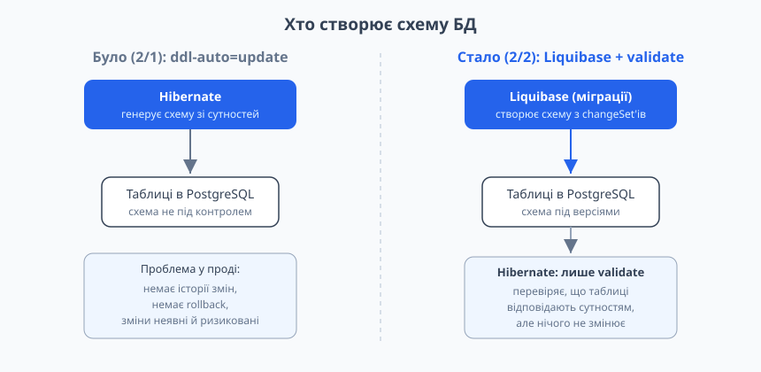
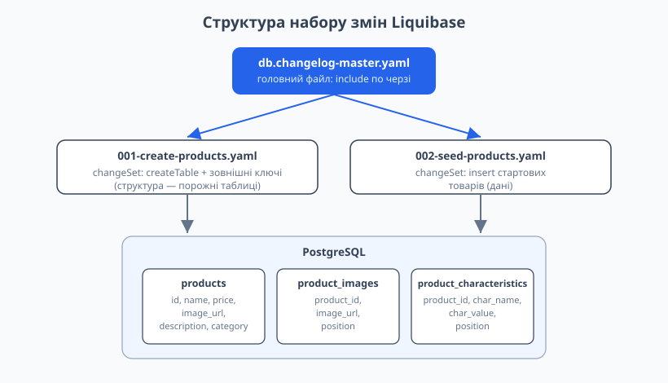

# Заняття 2.2. Міграції схеми бази даних із Liquibase

**Дисципліна:** Розробка застосунків на Spring Boot
**Модуль 2:** Робота з базами даних (PostgreSQL глибше)
**Тип заняття:** групове (2 год)

## Передумови

Заняття продовжує 2.1. Передбачається, що ви знайомі з підключенням застосунку до
PostgreSQL через Spring Data JPA, доменною моделлю як `@Entity`, запуском БД у Docker і
інтеграційними тестами на Testcontainers. Код цього заняття — приріст до застосунку 2.1.

## Навчальні результати

Після заняття студент здатен:

1. пояснити, чому схему бази даних ведуть окремими міграціями, а не генерацією з коду
   (`ddl-auto`);
2. підключити Liquibase до застосунку Spring Boot і вказати головний файл набору змін;
3. описати, що таке набір змін (*changelog*), окрема зміна (*changeset*) та службові таблиці
   `DATABASECHANGELOG` і `DATABASECHANGELOGLOCK`;
4. написати міграцію створення таблиць (`createTable`) і міграцію початкових даних (`insert`);
5. пояснити режим `ddl-auto: validate` і його роль поряд з міграціями.

Матеріал спирається на офіційну документацію Spring Boot, Liquibase та PostgreSQL
(див. «Джерела»).

---

## 1. Навіщо міграції замість `ddl-auto`

На занятті 2.1 таблиці створював Hibernate у режимі `ddl-auto: update`: він дивився на
`@Entity`-класи й сам змінював схему бази даних під них. Для перших кроків це зручно, але
для реального застосунку такий підхід має суттєві вади:

- **Немає історії змін.** Схема «виникає» зі стану класів; не видно, коли й що змінилося.
- **Немає відкату (rollback).** Якщо зміна виявилась помилковою, немає зафіксованого кроку,
  який можна скасувати.
- **Зміни неявні й ризиковані.** `update` може мовчки не застосувати потрібну зміну або
  застосувати не ту; на проді це небезпечно.

Рішення — **міграції схеми**: кожна зміна структури бази даних описується окремим кроком,
кроки нумеруються й зберігаються у проєкті під контролем версій, застосовуються по черзі й
фіксуються. Саме це робить **Liquibase**.



---

## 2. Що таке Liquibase: changelog, changeset і службові таблиці

**Liquibase** — інструмент керування змінами схеми бази даних. Опис змін зберігається у
**текстовому файлі набору змін** (*changelog*), який, за визначенням документації, «послідовно
перелічує всі зміни, внесені до бази даних» [1]. Файл набору змін виступає журналом, за яким
Liquibase виконує ще не застосовані зміни.

Окрему одиницю зміни в наборі називають **changeset** [1]. Кожен changeset має атрибути `id`
та `author`; разом зі шляхом та іменем файлу вони утворюють унікальний ідентифікатор зміни [1].

Щоб знати, які зміни вже застосовано, Liquibase веде дві службові таблиці прямо в базі:

- **`DATABASECHANGELOG`** — Liquibase використовує її, «щоб відстежувати, які зміни вже
  розгорнуто» [2]. Завдяки цьому той самий changeset не застосовується повторно: при кожному
  запуску Liquibase виконує лише нові changeset'и.
- **`DATABASECHANGELOGLOCK`** — Liquibase використовує її, «щоб гарантувати, що одночасно
  працює лише один екземпляр Liquibase» [3]. Це блокування не дає двом процесам змінювати
  схему одночасно (важливо, коли застосунок запущено в кількох копіях).

---

## 3. Підключення Liquibase до застосунку

### 3.1. Залежність

Для автоматичного запуску міграцій Liquibase під час старту до класного шляху додають
залежність `org.liquibase:liquibase-core` [4]:

```xml
<dependency>
    <groupId>org.liquibase</groupId>
    <artifactId>liquibase-core</artifactId>
</dependency>
```

Версію залежності визначає батьківський специфікатор залежностей Spring Boot, тому номер
версії не вказують. Коли ця залежність є у проєкті, міграції Liquibase виконуються за
замовчуванням як під час старту застосунку, так і перед запуском тестів [4].

> Примітка щодо версії Spring Boot. Окремий стартер `spring-boot-starter-liquibase`
> з'явився лише у Spring Boot 3.5. Курс зафіксовано на **3.4.x**, тому тут підключають саме
> `org.liquibase:liquibase-core` [4].

### 3.2. Головний файл набору змін

За замовчуванням головний файл набору змін читається зі шляху
`db/changelog/db.changelog-master.yaml`; змінити розташування можна властивістю
`spring.liquibase.change-log` [4]. У проєкті цей шлях задано явно (щоб документувати
розташування), хоча значення й збігається з типовим:

```yaml
spring:
  liquibase:
    change-log: classpath:db/changelog/db.changelog-master.yaml
```

### 3.3. `ddl-auto: validate`

Оскільки схему тепер створює Liquibase, Hibernate більше не повинен її змінювати. Тому режим
перемкнено з `update` на **`validate`**:

```yaml
spring:
  jpa:
    hibernate:
      ddl-auto: validate
```

У режимі `validate` Hibernate не створює й не змінює таблиці, а лише **перевіряє**, що наявна
схема відповідає `@Entity`-класам. Якщо таблиця або колонка не збігається з очікуваною —
застосунок не стартує. Так єдиним джерелом схеми лишаються міграції, а `validate` слугує
запобіжником: сутності та реальна схема не розійдуться непомітно.

---

## 4. Структура набору змін

Набір змін організовано так: головний файл лише **підключає** (`include`) окремі файли змін
по черзі. Кожен файл — одна зрозуміла зміна; історія лишається читабельною.



Головний файл
[`db.changelog-master.yaml`](../../amazonua-gz22/src/main/resources/db/changelog/db.changelog-master.yaml):

```yaml
databaseChangeLog:
  - include:
      file: db/changelog/changes/001-create-products.yaml
  - include:
      file: db/changelog/changes/002-seed-products.yaml
```

---

## 5. Міграція 1: створення таблиць (`createTable`)

Перша зміна створює три таблиці, що відповідають сутностям заняття 2.1: `products`, а також
`product_images` і `product_characteristics` — таблиці колекцій значень
(`@ElementCollection`), пов'язані з `products` зовнішнім ключем. Фрагмент
[`001-create-products.yaml`](../../amazonua-gz22/src/main/resources/db/changelog/changes/001-create-products.yaml):

```yaml
databaseChangeLog:
  - changeSet:
      id: 001-create-products
      author: amazonua
      changes:
        - createTable:
            tableName: products
            columns:
              - column:
                  name: id
                  type: bigint
                  autoIncrement: true          # у PostgreSQL → GENERATED BY DEFAULT AS IDENTITY
                  constraints: { primaryKey: true, nullable: false }
              - column:
                  name: name
                  type: varchar(255)
                  constraints: { nullable: false }
              - column:
                  name: price
                  type: numeric(19, 2)
                  constraints: { nullable: false }
              # image_url, description (varchar 2000), category — нижче у файлі
```

**Важливо: імена й типи колонок мають точно збігатися з тим, що очікує Hibernate** (бо
`ddl-auto: validate`). Наприклад, колонку значення характеристики названо `char_value`, бо
`VALUE` — зарезервоване слово SQL; колонка `position` зберігає порядок елементів колекції
(`@OrderColumn`). Якщо тип чи ім'я колонки розійдеться із сутністю, застосунок не стартує —
це й є захист, який дає `validate`.

---

## 6. Міграція 2: початкові дані (`insert`)

Раніше стартові товари додавав компонент `ProductSeeder` у коді (під час старту, якщо база
порожня). Тепер початкові дані теж під версіями — їх вставляє окремий changeset. Фрагмент
[`002-seed-products.yaml`](../../amazonua-gz22/src/main/resources/db/changelog/changes/002-seed-products.yaml):

```yaml
- changeSet:
    id: 002-seed-products
    author: amazonua
    changes:
      - insert:
          tableName: products
          columns:
            - column: {name: id, valueNumeric: 1}
            - column: {name: name, value: "Навушники AudioPro X1"}
            - column: {name: price, valueNumeric: 1299.00}
            # ... image_url, description, category
      # далі — рядки product_images і product_characteristics цього товару
```

Два моменти, важливі для коректності:

1. **Явні `id` (1..4).** Їх задають, щоб рядки колекцій (`product_images`,
   `product_characteristics`) однозначно посилалися на свій товар через `product_id`.
2. **Зсув лічильника IDENTITY.** Колонка `id` у PostgreSQL — це стовпець-ідентичність
   (`GENERATED ... AS IDENTITY`) [5]. Після вставки з явними `id` його внутрішній лічильник не
   зсувається сам. Тому наприкінці changeset виконує
   `ALTER TABLE products ALTER COLUMN id RESTART WITH 5`, інакше перший товар, доданий через
   `POST`, отримав би `id=1` і впав на порушенні унікальності первинного ключа.

`ProductSeeder` у проєкті лишається (він потрібен для профілю зберігання в пам'яті та як
запобіжник), але на PostgreSQL він побачить, що товари вже є, і нічого не додасть.

---

## 7. Як це працює при старті


Під час старту застосунку (за наявності залежності `liquibase-core`) Liquibase:

1. читає головний файл набору змін;
2. звіряється з таблицею `DATABASECHANGELOG` — які changeset'и вже застосовано;
3. застосовує по черзі **лише нові** changeset'и (уже застосовані пропускає);
4. записує кожен застосований changeset рядком у `DATABASECHANGELOG`.

Після цього Hibernate у режимі `validate` перевіряє відповідність схеми сутностям — і лише
тоді застосунок продовжує запуск. Повторний старт на тій самій базі не застосовує міграції
вдруге: у журналі вже є відповідні записи.

---

## 8. Контракти API не змінилися

Міграції змінюють лише **спосіб ведення схеми**, а не контракти застосунку. Ендпоінти
(`GET/POST/PUT/DELETE /api/products`, фільтри, `GET /api/products/categories`) працюють так
само, як на 2.1. Контролер, сервіс і DTO не змінювалися — змінилися конфігурація (`pom.xml`,
`application.yaml`) та додалися файли міграцій. Приклади запитів — у файлі
[`requests.md`](./requests.md).

---

## 9. Тестування

До наявних тестів додано інтеграційний тест
[`LiquibaseMigrationIntegrationTest`](../../amazonua-gz22/src/test/java/com/ua/amazonua/LiquibaseMigrationIntegrationTest.java),
що перевіряє саме роботу міграцій на реальному PostgreSQL (через Testcontainers):

- таблиця `DATABASECHANGELOG` містить записи про обидва наші changeset'и;
- таблиці, створені міграцією (`products`, `product_images`, `product_characteristics`),
  існують;
- seed-міграцію застосовано (перевіряємо за журналом, а не за кількістю рядків: інші
  автономні тести на спільній базі очищають дані у `@BeforeEach`, тож рядки можуть бути вже
  видалені, а журнал міграцій це не зачіпає).

Решта тестів (модульні, зрізовий `@WebMvcTest`, наскрізні `@SpringBootTest`) лишаються з 2.1
і проходять без змін — тепер проти схеми, яку створив Liquibase, а не Hibernate.

---

## 10. Запуск і перевірка

### Вимоги до середовища

Проєкт використовує **Spring Boot 3.4.13** та **Java 21**. Якщо в системі типово задіяно
новішу версію JDK, перед запуском слід явно вказати Java 21 через `JAVA_HOME`.

### Підняти БД і застосунок

```bash
cd amazonua-gz22
docker compose up -d          # PostgreSQL у Docker
./mvnw spring-boot:run        # застосунок; Liquibase застосує міграції при старті
```

У логах старту видно рядки Liquibase: `ChangeSet ... ran successfully` і підсумок
`UPDATE SUMMARY` з кількістю застосованих змін. Перелік товарів: `http://localhost:8080/api/products`.

### Переконатися, що схему створив Liquibase

```bash
docker exec -it amazonua-postgres psql -U amazonua -d amazonua \
  -c "SELECT id, author, filename FROM databasechangelog ORDER BY orderexecuted;"
```

### Чиста база (перевірка «з нуля»)

```bash
docker compose down -v        # видалити том разом із даними
docker compose up -d          # піднятися заново — міграції створять схему й дані самі
```

### Порт 8080 уже зайнято (`Port 8080 was already in use`)

Якщо запуск завершується цією помилкою, порт займає інший процес. Знайти й завершити
(macOS/Linux):
```bash
lsof -i :8080
kill $(lsof -t -i :8080)      # kill -9 за потреби
```
Windows:
```bash
netstat -ano | findstr :8080
taskkill /PID <PID> /F
```
Або запустити на іншому порту:
`./mvnw spring-boot:run -Dspring-boot.run.arguments=--server.port=8081`.

### Тести (проти реального Postgres через Testcontainers)

```bash
cd amazonua-gz22
JAVA_HOME="$(/usr/libexec/java_home -v 21)" ./mvnw test
```

> Для тестів потрібен запущений Docker (Testcontainers піднімає PostgreSQL у контейнері).
> На Rancher Desktop прибиральник контейнерів Ryuk вимкнено на рівні проєкту (`pom.xml`),
> тому при аварійному завершенні (`kill -9`) контейнери можуть лишитися — чистити вручну.

---

## 11. Завдання для самостійної роботи

Самостійна робота — продовження **власного проєкту**: перевести ведення схеми вашої сутності
на Liquibase. Повна покрокова інструкція та діаграми — в окремому файлі:

**→ [`gz22_student_task.md`](./gz22_student_task.md)**

Коротко очікуваний результат:
1. Підключено `liquibase-core`; `ddl-auto: validate`.
2. Міграція `createTable` для вашої таблиці (+ таблиці колекцій, якщо є) і міграція `insert`
   стартових даних; на чистій базі все створюється й наповнюється само.
3. Другий changeSet, що додає ще кілька записів.
4. Опис у README, що станеться, якщо змінити вже застосований changeSet (контрольна сума).

---

## Джерела

1. Liquibase Documentation. *Changelogs.* https://docs.liquibase.com/concepts/changelogs/home.html
2. Liquibase Documentation. *DATABASECHANGELOG table.* https://docs.liquibase.com/concepts/tracking-tables/databasechangelog-table.html
3. Liquibase Documentation. *DATABASECHANGELOGLOCK table.* https://docs.liquibase.com/concepts/tracking-tables/databasechangeloglock-table.html
4. Spring Boot Documentation. *Execute Liquibase Database Migrations on Startup.* https://docs.spring.io/spring-boot/how-to/data-initialization.html
5. PostgreSQL Documentation. *Identity Columns (GENERATED ... AS IDENTITY).* https://www.postgresql.org/docs/current/ddl-identity-columns.html
