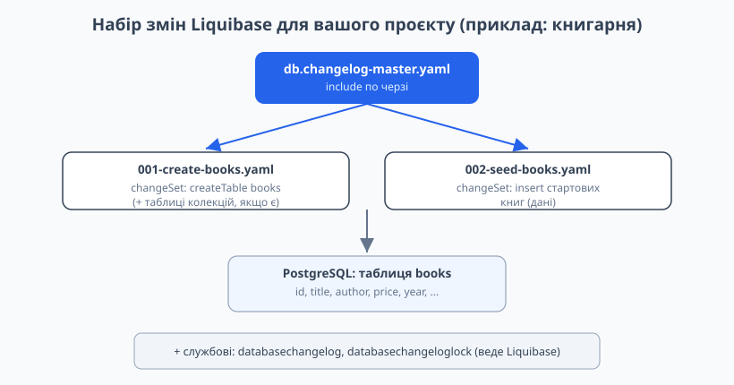

# Самостійна робота до заняття 2.2 — міграції схеми з Liquibase (лише backend)

## Мета

Перевести ведення схеми бази даних у **власному проєкті** з генерації Hibernate (`ddl-auto`)
на **міграції Liquibase**: схему та початкові дані тепер створюють версіоновані файли змін,
а Hibernate лише перевіряє відповідність (`validate`). Лише backend, у **власному
репозиторії**. Наскрізний приклад тут — книгарня (сутність `Book`).

## Бали

Заняття **2/2 (ГЗ)** — максимум **4 бали**.

Бали виставляються за результатами **усного опитування викладача** — **4 питання по 1 балу**
за кожне. Питання стосуються **пройденого на занятті матеріалу та цієї самостійної роботи**,
наприклад: чому міграції кращі за `ddl-auto` у проді; що таке changelog, changeset і таблиці
`DATABASECHANGELOG` / `DATABASECHANGELOGLOCK`; що робить режим `ddl-auto: validate`; чому міграції
не застосовуються повторно; що станеться, якщо змінити вже застосований changeSet (контрольна сума).

## Передумови

Виконана самостійна робота до 2.1: ваша сутність уже зберігається в PostgreSQL через JPA,
БД піднімається з Docker. Ця робота — приріст до того проєкту.

## Що має вийти



---

## Крок 1. Додати залежність Liquibase

У `pom.xml` додайте (версію не вказуйте — нею керує Spring Boot):
```xml
<dependency>
    <groupId>org.liquibase</groupId>
    <artifactId>liquibase-core</artifactId>
</dependency>
```
Для Spring Boot 3.4 це саме `liquibase-core` (окремий `spring-boot-starter-liquibase` —
лише з 3.5).

## Крок 2. Переключити Hibernate на `validate`

У `application.yaml`:
```yaml
spring:
  jpa:
    hibernate:
      ddl-auto: validate      # було update; тепер схему веде Liquibase
  liquibase:
    change-log: classpath:db/changelog/db.changelog-master.yaml
```

## Крок 3. Створити головний файл набору змін

Файл `src/main/resources/db/changelog/db.changelog-master.yaml`, що лише підключає зміни:
```yaml
databaseChangeLog:
  - include:
      file: db/changelog/changes/001-create-books.yaml
  - include:
      file: db/changelog/changes/002-seed-books.yaml
```

## Крок 4. Міграція створення таблиці (`createTable`)

Файл `.../changes/001-create-books.yaml`. ПІДКАЗКА: типи й імена колонок мають збігатися з
тим, що очікує Hibernate для вашої сутності (інакше `validate` не пройде й застосунок не
стартує). Скелет (доповніть своїми полями):
```yaml
databaseChangeLog:
  - changeSet:
      id: 001-create-books
      author: <ваш-логін>
      changes:
        - createTable:
            tableName: books
            columns:
              - column:
                  name: id
                  type: bigint
                  autoIncrement: true
                  constraints: { primaryKey: true, nullable: false }
              - column:
                  name: title
                  type: varchar(255)
                  constraints: { nullable: false }
              # price (numeric), author, year ... — ваші поля
```
Якщо є колекції (`@ElementCollection`) — додайте їх таблиці та `addForeignKeyConstraint`
(як на занятті для `product_images` / `product_characteristics`).

## Крок 5. Міграція початкових даних (`insert`)

Файл `.../changes/002-seed-books.yaml`. Вставте 3–4 стартові записи. ПІДКАЗКА: якщо задаєте
`id` явно, наприкінці зсуньте лічильник автоінкремента, щоб перший запис через `POST` не
отримав уже зайнятий `id`:
```yaml
      changes:
        - insert:
            tableName: books
            columns:
              - column: {name: id, valueNumeric: 1}
              - column: {name: title, value: "..."}
              # ...
        - sql:
            sql: "ALTER TABLE books ALTER COLUMN id RESTART WITH 5"
```

## Крок 6. Перевірити на чистій базі

```bash
docker compose down -v        # видалити том
docker compose up -d
./mvnw spring-boot:run
```
У логах Liquibase — `ChangeSet ... ran successfully`. Переконайтеся:
```bash
docker exec -it <ваш-postgres> psql -U <user> -d <db> \
  -c "SELECT id, author, filename FROM databasechangelog ORDER BY orderexecuted;"
```

## Крок 7. Додати другий changeSet і дослідити контрольну суму

1. Додайте окремий changeSet (новий `id`), що вставляє ще 2–3 записи; перезапустіть —
   застосується лише він, старі пропустяться.
2. Спробуйте **змінити вже застосований** changeSet (напр. правку в seed) і перезапустити.
   Опишіть у README, що станеться (помилка невідповідності контрольної суми checksum) і
   чому так: застосовані зміни редагувати не можна — лише додавати нові.

---

## Що здати

1. У **вашому** репозиторії — підключений Liquibase, `ddl-auto: validate`.
2. Міграція `createTable` вашої таблиці (+ таблиці колекцій, якщо є) і міграція `insert`.
3. Другий changeSet, що додає ще кілька записів.
4. У README — опис поведінки при зміні вже застосованого changeSet (контрольна сума).

## Критерії

- На чистій базі (`down -v` → `up`) схема й дані створюються міграціями самі.
- `ddl-auto: validate`; застосунок стартує (схема збігається із сутностями).
- Є щонайменше два окремі changeSet'и; повторний старт не застосовує їх удруге.
- Предметна область власна (поля відрізняються від еталона).
