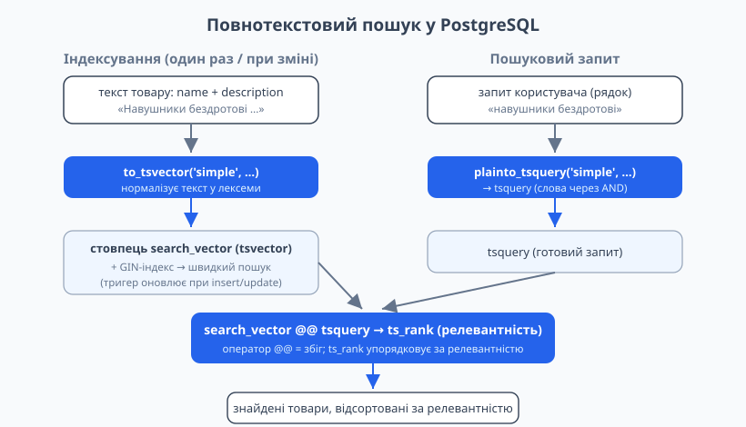
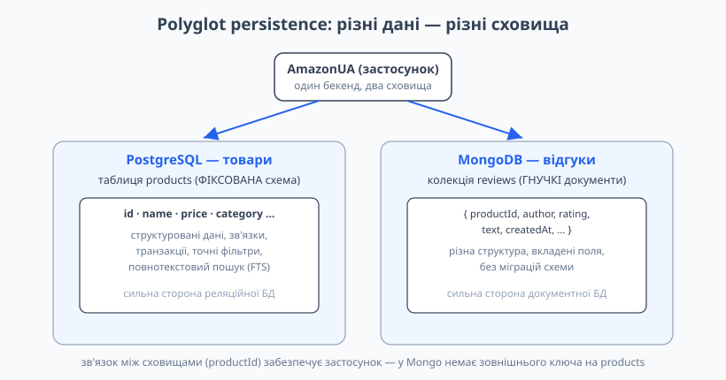
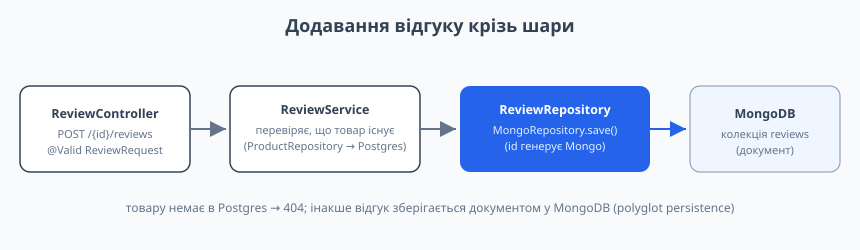

# Заняття 2.4. Повнотекстовий пошук PostgreSQL та MongoDB для відгуків (pgvector оглядово)

**Дисципліна:** Розробка застосунків на Spring Boot
**Модуль 2:** Робота з базами даних (PostgreSQL глибше + MongoDB)
**Тип заняття:** групове (2 год)

## Передумови

Заняття продовжує 2.1–2.2. Передбачається, що ви знайомі з підключенням до PostgreSQL через
Spring Data JPA, міграціями Liquibase, пагінацією, запуском БД у Docker та інтеграційними
тестами на Testcontainers. Код цього заняття — приріст до застосунку 2.2.

## Навчальні результати

Після заняття студент здатен:

1. пояснити, чому пошук через `LIKE` непридатний як повноцінний текстовий пошук, і що дає
   повнотекстовий пошук (FTS) PostgreSQL;
2. описати типи `tsvector` і `tsquery`, функції `to_tsvector`/`plainto_tsquery`, оператор
   збігу `@@`, GIN-індекс і ранжування `ts_rank`;
3. реалізувати ендпоінт повнотекстового пошуку через нативний запит JPA;
4. пояснити, коли доречна документна база даних (MongoDB), а коли реляційна;
5. зберігати документи в MongoDB через Spring Data (`@Document`, `MongoRepository`) і
   застосувати **polyglot persistence** (різні дані — у різних сховищах);
6. мати уявлення (оглядово) про векторний пошук через розширення **pgvector**.

Матеріал спирається на офіційну документацію PostgreSQL, Spring Data MongoDB та pgvector
(див. «Джерела»).

---

## 1. Чому `LIKE` — не пошук

На занятті 2.1 текстовий фільтр був зроблений через SQL `LIKE '%текст%'`. Він шукає **точний
підрядок буква-в-букву** і має суттєві вади як пошук: не знаходить за окремими словами в
будь-якому порядку, не ранжує за релевантністю, а шаблон `%...%` не може використати індекс
(повний скан таблиці). Для реального пошуку потрібен інший механізм — **повнотекстовий пошук**
(*full-text search, FTS*).

PostgreSQL надає повнотекстовий пошук вбудовано: він дає «можливість знаходити документи
природною мовою, що задовольняють запит, і за потреби сортувати їх за релевантністю до
запиту» [1].

---

## 2. Як працює повнотекстовий пошук PostgreSQL



FTS працює з двома спеціальними типами даних [1]:

- **`tsvector`** — тип «для зберігання попередньо оброблених документів». Текст перетворюють
  у `tsvector` функцією **`to_tsvector`**, яка «розбирає й нормалізує рядок документа» [1].
- **`tsquery`** — тип «для представлення оброблених запитів». Текст користувача перетворюють
  на `tsquery` функцією **`plainto_tsquery`**, яка нормалізує слова введеного тексту (і сама
  ставить між ними логічне «І») [1].

Збіг документа й запиту перевіряє **оператор `@@`**: він «повертає `true`, якщо `tsvector`
(документ) відповідає `tsquery` (запит)» [1]. Релевантність (наскільки добре збіглося)
рахує функція ранжування **`ts_rank`** — за нею сортують результати.

### 2.1. Міграція: стовпець `tsvector` + GIN-індекс + тригер

Щоб не перетворювати текст на льоту при кожному пошуку, у таблицю `products` додано
окремий стовпець `search_vector` типу `tsvector`, заповнений із `name` і `description`.
По ньому створено **GIN-індекс** — саме він робить пошук `@@` швидким (замість повного скану).
Тригер оновлює `search_vector` при зміні товару. Фрагмент
[`008-fts-search-vector.yaml`](../../amazonua-gz24/src/main/resources/db/changelog/changes/008-fts-search-vector.yaml):

```sql
ALTER TABLE products ADD COLUMN search_vector tsvector;
UPDATE products SET search_vector =
    to_tsvector('simple', coalesce(name,'') || ' ' || coalesce(description,''));
CREATE INDEX idx_products_search_vector ON products USING GIN (search_vector);
-- + тригер, що перераховує search_vector при INSERT/UPDATE
```

> Про конфігурацію `'simple'`. Перший аргумент `to_tsvector` — конфігурація пошуку. `'simple'`
> лише розбиває текст на слова (лексеми) без мовного **стемінгу** (зведення словоформ до
> основи). Для англійської можна взяти `'english'` (тоді `cats` і `cat` збігатимуться), але
> для української вбудованої конфігурації немає, тож `'simple'` — найбезпечніший вибір:
> пошук за словами працює, але без розуміння словоформ. Стовпець `search_vector` **не
> мапимо в `@Entity`** — це суто БД-колонка, яку Hibernate `validate` не перевіряє.

### 2.2. Ендпоінт пошуку (нативний запит)

FTS виконуємо нативним SQL (`nativeQuery = true`), бо JPQL операторів FTS не має. Фрагмент
[`ProductJpaRepository`](../../amazonua-gz24/src/main/java/com/ua/amazonua/repository/jpa/ProductJpaRepository.java):

```java
@Query(value = """
    SELECT * FROM products
    WHERE search_vector @@ plainto_tsquery('simple', :q)
    ORDER BY ts_rank(search_vector, plainto_tsquery('simple', :q)) DESC, id
    """, nativeQuery = true)
List<Product> searchFullText(@Param("q") String q);
```

Ендпоінт — `GET /api/products/search?q=...` (оголошено **перед** `/{id}` — сталий сегмент
раніше за змінну). Пошук проходить тим самим ланцюгом DIP: інтерфейс репозиторію → адаптер →
сервіс → контролер. Інтеграційний тест фіксує, що пошук знаходить за **словом**, а не
підрядком, і що кілька слів у запиті звужують результат (AND).

---

## 3. MongoDB: коли і як

### 3.1. Коли документна база доречна

Товар має сталу структуру (назва, ціна, категорія) — це добре лягає в реляційну таблицю з
фіксованою схемою. Але **відгуки** на товар структурно різноманітніші (рейтинг, текст, дата,
можливі фото, відповіді) і їх зручно зберігати як **гнучкі документи**, не оголошуючи схему
наперед і не пишучи міграцій під кожну зміну.

Саме для таких даних підходить **документна база даних** — MongoDB. Чесно про межі: Mongo
програє реляційній там, де потрібні транзакції між багатьма сутностями та складні з'єднання
(`join`). Тому тут застосовуємо **polyglot persistence**: товари лишаються в PostgreSQL, а
відгуки зберігаємо в MongoDB.



### 3.2. Документ і репозиторій

Клас-документ позначають анотацією `@Document` — вона «застосовується на рівні класу, щоб
позначити його кандидатом на відображення в базу; можна вказати назву колекції, де
зберігатимуться дані» [2]. Поле ідентифікатора позначають `@Id` — воно «мапиться на поле
`_id` документа» [2]. Фрагмент
[`Review`](../../amazonua-gz24/src/main/java/com/ua/amazonua/domain/Review.java):

```java
@Document("reviews")
public class Review {
    @Id private String id;
    private Long productId;   // зв'язок із товаром у PostgreSQL (НЕ зовнішній ключ БД)
    private String author;
    private int rating;       // 1..5
    private String text;
    private Instant createdAt;
}
```

Репозиторій успадковують від `MongoRepository` — Spring Data генерує реалізацію. Похідний
метод (derived query) будується за іменем:
[`ReviewRepository`](../../amazonua-gz24/src/main/java/com/ua/amazonua/repository/mongo/ReviewRepository.java):

```java
public interface ReviewRepository extends MongoRepository<Review, String> {
    List<Review> findByProductIdOrderByCreatedAtDesc(Long productId);
}
```

### 3.3. Узгодженість між сховищами — на боці застосунку

Між PostgreSQL і MongoDB **немає зовнішнього ключа**: поле `productId` у відгуку — звичайне
поле. Тому перш ніж додати відгук, сервіс перевіряє, що товар існує в PostgreSQL (інакше
`404`). Узгодженість двох сховищ забезпечує код застосунку, а не БД — це ключова риса
polyglot-підходу.



Ендпоінти відгуків — під-ресурс товару
([`ReviewController`](../../amazonua-gz24/src/main/java/com/ua/amazonua/web/ReviewController.java)):

| Метод | Шлях | Призначення |
|---|---|---|
| `GET` | `/api/products/{id}/reviews` | відгуки товару (найновіші спершу) |
| `POST` | `/api/products/{id}/reviews` | додати відгук (`201 Created`; `404`, якщо товару немає) |

Для MongoDB **транзакцій (як у JPA) тут не використовуємо** — операція над одним документом
атомарна сама собою; це типовий підхід для документної БД.

---

## 4. Векторний пошук (pgvector) — оглядово

Це **додаткова, оглядова** частина — щоб знати про існування підходу. Для рекомендацій
«схожі товари» порівнюють не слова, а **ембединги** — числові вектори, близькість яких
відповідає смисловій схожості. PostgreSQL уміє це з розширенням **pgvector** [3].

```sql
CREATE EXTENSION vector;                         -- увімкнути розширення
ALTER TABLE products ADD COLUMN embedding vector(384);   -- вектор фіксованої довжини
-- знайти 5 найсхожіших до заданого вектора:
SELECT * FROM products ORDER BY embedding <-> '[...]' LIMIT 5;
```

Оператори відстані pgvector [3]: `<->` — евклідова (L2) відстань; `<=>` — косинусна відстань;
`<#>` — (від'ємний) скалярний добуток. На цьому занятті pgvector **не реалізуємо** — лише
згадка; саму реалізацію винесено на самопідготовку (за бажанням).

---

## 5. Клієнтська частина

- **Пошук на головній** тепер іде на `GET /api/products/search` (FTS) замість `LIKE`: щойно
  в полі з'являється текст, показуються картки, знайдені повнотекстовим пошуком за словами й
  релевантністю.
- **Відгуки на сторінці товару** (`amazonua-ui-gz24`): під деталями — блок відгуків із
  MongoDB (список найновіших + середня оцінка) і **форма додавання відгуку з оцінкою зірками**
  (ім'я, рейтинг 1–5, текст). Після надсилання список оновлюється.

---

## 6. Тестування

Інтеграційні тести тепер працюють проти **двох** реальних БД через Testcontainers —
PostgreSQL і MongoDB (обидва singleton-контейнери у
[`AbstractIntegrationTest`](../../amazonua-gz24/src/test/java/com/ua/amazonua/AbstractIntegrationTest.java)).

- FTS: [`ProductApiIntegrationTest`](../../amazonua-gz24/src/test/java/com/ua/amazonua/web/ProductApiIntegrationTest.java)
  перевіряє, що пошук знаходить за словом (а не підрядком) і що кілька слів звужують результат.
- Відгуки: [`ReviewApiIntegrationTest`](../../amazonua-gz24/src/test/java/com/ua/amazonua/web/ReviewApiIntegrationTest.java)
  перевіряє додавання/читання відгуків через Mongo, `404` на відгук до неіснуючого товару,
  `400` на некоректний рейтинг, ізоляцію відгуків за товарами.

Усі інтеграційні тести **автономні**: перед кожним тестом обидва сховища очищаються, і кожен
тест сам готує свої дані.

---

## 7. Запуск і перевірка

### Вимоги до середовища

**Spring Boot 3.4.13**, **Java 21**. Якщо типово задіяно новішу JDK — вкажіть Java 21 через
`JAVA_HOME`.

### Підняти БД і застосунок

```bash
cd amazonua-gz24
docker compose up -d          # PostgreSQL + MongoDB у Docker
./mvnw spring-boot:run
```

Пошук: `curl "http://localhost:8080/api/products/search?q=навушники"`.
Відгуки: `curl http://localhost:8080/api/products/1/reviews`.

### Порт 8080 уже зайнято

```bash
lsof -i :8080
kill $(lsof -t -i :8080)      # kill -9 за потреби
```
Windows: `netstat -ano | findstr :8080` → `taskkill /PID <PID> /F`. Або
`./mvnw spring-boot:run -Dspring-boot.run.arguments=--server.port=8081`.

### Тести (проти реальних Postgres і MongoDB через Testcontainers)

```bash
cd amazonua-gz24
JAVA_HOME="$(/usr/libexec/java_home -v 21)" ./mvnw test
```

> Потрібен запущений Docker (Testcontainers піднімає Postgres і Mongo в контейнерах). На
> Rancher Desktop Ryuk вимкнено на рівні проєкту (`pom.xml`) — при `kill -9` контейнери
> можуть лишитися, чистити вручну. Перший прогін завантажує образ `mongo:7` — трохи довше.

---

## 8. Завдання для самостійної роботи

Самостійна робота — продовження **власного проєкту**: додати FTS-пошук та документну
колекцію для своєї сутності. Повна покрокова інструкція — в окремому файлі:

**→ [`gz24_student_task.md`](./gz24_student_task.md)**

Коротко очікуваний результат:
1. Міграція `tsvector` + GIN-індекс для вашої сутності; ендпоінт пошуку `/search`.
2. Документна колекція MongoDB для доречної сутності (напр. відгуки/коментарі) з CRUD.
3. У README — пояснення, ЧОМУ саме ця сутність у Mongo, а не в Postgres.
4. Оглядово (за бажанням): pgvector — ендпоінт «схожі записи» за ембедингом.

---

## Джерела

1. PostgreSQL Documentation. *Full Text Search — Introduction (tsvector, tsquery, to_tsvector, @@).* https://www.postgresql.org/docs/current/textsearch-intro.html
2. Spring Data MongoDB Documentation. *Mapping — @Document and @Id.* https://docs.spring.io/spring-data/mongodb/reference/mongodb/mapping/mapping.html
3. pgvector. *Open-source vector similarity search for Postgres (vector type; `<->`, `<=>`, `<#>`).* https://github.com/pgvector/pgvector
