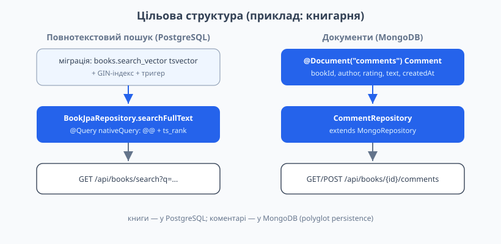

# Самостійна робота до заняття 2.4 — FTS-пошук та MongoDB (лише backend)

## Мета

Додати у **власний проєкт** два механізми, показані на занятті: **повнотекстовий пошук
(FTS)** для своєї сутності в PostgreSQL і **документну колекцію MongoDB** для доречних даних
(напр. коментарі/відгуки). Лише backend, у **власному репозиторії**. Наскрізний приклад —
книгарня (`Book` + коментарі `Comment`).

## Бали

Заняття **2/4 (ГЗ)** — максимум **4 бали**.

Бали виставляються за результатами **усного опитування викладача** — **4 питання по 1 балу**
за кожне. Питання стосуються **пройденого на занятті матеріалу та цієї самостійної роботи**,
наприклад: чому `LIKE` не є повноцінним пошуком і що дає FTS; що таке `tsvector`, `tsquery`,
`to_tsvector`/`plainto_tsquery`, оператор `@@`, GIN-індекс і `ts_rank`; коли документна БД
доречніша за реляційну; як працюють `@Document`/`MongoRepository` і що таке polyglot persistence;
як забезпечується узгодженість даних між Postgres і Mongo.

## Передумови

Виконано самостійні роботи 2.1–2.2: ваша сутність уже зберігається в PostgreSQL через JPA,
схему веде Liquibase, БД піднімається з Docker. Ця робота — приріст до того проєкту.

## Що має вийти



---

## Крок 1. Додати MongoDB у залежності й Docker

- `pom.xml`: додайте `spring-boot-starter-data-mongodb`; для тестів — `org.testcontainers:mongodb`.
- `docker-compose.yml`: додайте сервіс `mongo` (образ `mongo:7`, порт 27017, том, healthcheck).
- `application.yaml`: `spring.data.mongodb.uri: mongodb://localhost:27017/<ваша-база>`.

## Крок 2. FTS: міграція search_vector + GIN-індекс + тригер

Окремим changeSet (новий файл) для вашої таблиці:
```sql
ALTER TABLE books ADD COLUMN search_vector tsvector;
UPDATE books SET search_vector =
    to_tsvector('simple', coalesce(title,'') || ' ' || coalesce(description,''));
CREATE INDEX idx_books_search_vector ON books USING GIN (search_vector);
-- + тригер, що оновлює search_vector при INSERT/UPDATE (як на занятті)
```
ПІДКАЗКА: `'simple'` — без мовного стемінгу (для української вбудованої конфігурації немає).
Стовпець `search_vector` у сутність НЕ додавайте — це суто БД-колонка.

## Крок 3. FTS: ендпоінт пошуку (нативний запит)

У Spring Data репозиторії:
```java
@Query(value = """
    SELECT * FROM books
    WHERE search_vector @@ plainto_tsquery('simple', :q)
    ORDER BY ts_rank(search_vector, plainto_tsquery('simple', :q)) DESC, id
    """, nativeQuery = true)
List<Book> searchFullText(@Param("q") String q);
```
Проведіть його через свій доменний інтерфейс репозиторію → сервіс → контролер
(`GET /api/books/search?q=...`). Маршрут `/search` оголосіть ПЕРЕД `/{id}`.

## Крок 4. MongoDB: документ і репозиторій

```java
@Document("comments")
public class Comment {
    @Id private String id;
    private Long bookId;      // зв'язок із книгою у PostgreSQL (не зовнішній ключ)
    private String author;
    private int rating;       // 1..5
    private String text;
    private Instant createdAt;
}

public interface CommentRepository extends MongoRepository<Comment, String> {
    List<Comment> findByBookIdOrderByCreatedAtDesc(Long bookId);
}
```

## Крок 5. MongoDB: сервіс і контролер (під-ресурс)

- Сервіс перед додаванням коментаря перевіряє, що книга існує в PostgreSQL (інакше `404`) —
  узгодженість між сховищами на боці застосунку.
- Контролер: `GET /api/books/{id}/comments` (найновіші спершу) і
  `POST /api/books/{id}/comments` (`201 Created`; вхідний DTO з валідацією рейтингу 1..5).

## Крок 6. Інтеграційні тести (Testcontainers: Postgres + Mongo)

Додайте MongoDB-контейнер у ваш базовий тест-клас поряд із Postgres (singleton +
`@DynamicPropertySource` на `spring.data.mongodb.uri`). Тести **автономні**: `@BeforeEach`
чистить обидва сховища; кожен тест сам створює дані. Перевірте: FTS знаходить за словом;
додавання/читання коментарів; `404` на коментар до неіснуючої книги.

## Крок 7 (оглядово, за бажанням). pgvector

Увімкніть розширення (`CREATE EXTENSION vector`), додайте стовпець `embedding vector(N)` і
зробіть ендпоінт «схожі записи» (`ORDER BY embedding <-> :vec LIMIT 5`). Можна на фіктивних
векторах. Це не оцінюється як основне — лише для ознайомлення.

---

## Що здати

1. FTS-пошук своєї сутності: міграція `tsvector` + GIN-індекс + ендпоінт `/search`.
2. Документна колекція MongoDB (коментарі/відгуки) з CRUD (під-ресурс сутності).
3. Інтеграційні тести проти реальних Postgres і Mongo — зелені.
4. У README — пояснення, ЧОМУ саме ця сутність/дані у Mongo, а не в Postgres.

## Критерії

- FTS знаходить за словами й ранжує (не `LIKE`); пошук проходить через усі шари (DIP).
- Mongo-колекція працює; товар/книга перевіряється перед додаванням коментаря (404, якщо немає).
- Тести автономні (чистять обидва сховища) і зелені.
- Предметна область власна (поля відрізняються від еталона).
